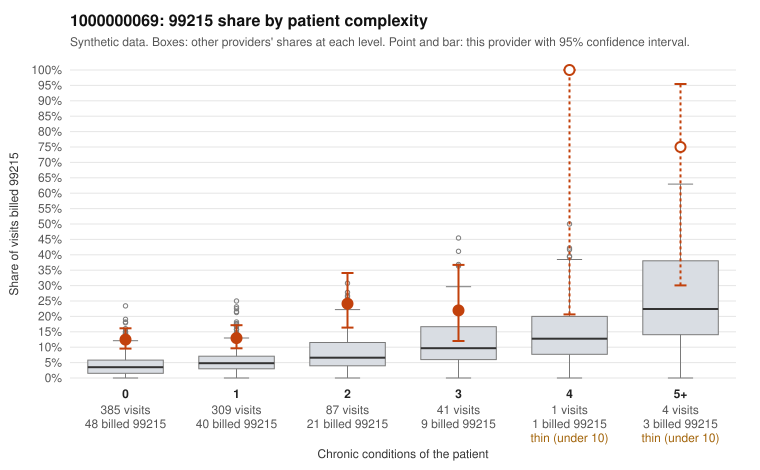

# 1000000069: 1000000069: too few returned records to judge

**Leaning (advisory):** Inconclusive

## Why

1000000069 billed 99215 on 14.8% of 827 claims against an expected 4.3% given patient complexity (risk-adjusted score 5.36; plain z-score vs peers 1.11). 72% of this provider's 99215 claims were on patients with 0 or 1 chronic conditions. Records came back for 29 claims. Of 4 documented 99215 claims, 1 (25%) were documented below the billed level, against 28% for the comparison providers. Note checks on 29 returned notes (share showing each sign): problems 38%, late 3%, unsigned 0%, data 3%. No audit trail was received. 2 of 24 notes claiming moderate-or-higher data reviewed had no lab or test line on the claim. The evidence does not support a call either way yet. Examples: C0041561: billed 99215, patient aged 57 with 0 chronic condition(s); documented MDM level low, minutes not recorded. C0041565: billed 99215, patient aged 58 with 1 chronic condition(s) (hyperlipidemia).

## Evidence chart

## Cited claims

`C0041561`, `C0041565`

## Suggested next steps

- 29 charts came back but do not settle it: request a targeted sample of 99215 charts, starting with C0041561, C0041565.
- Re-check after the targeted charts arrive; do not call upcoding or a sicker panel on this evidence alone.

---
Citations checked: 2/2 valid. Synthetic data. The leaning is advisory; the flag comes from the statistical screen, and no clinical documentation is available beyond the sampled records-review facts shown in the packet.
