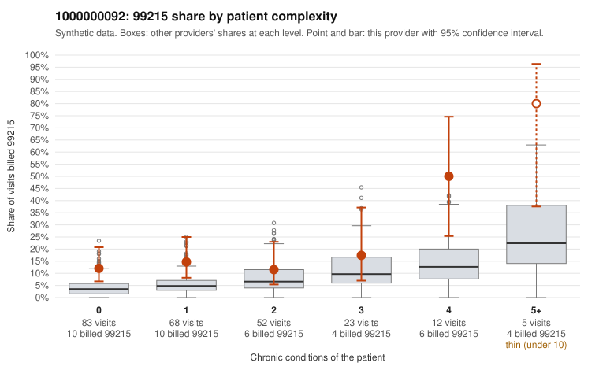

# 1000000092: 1000000092: too few returned records to judge

**Leaning (advisory):** Inconclusive

## Why

1000000092 billed 99215 on 16.5% of 243 claims against an expected 5.3% given patient complexity (risk-adjusted score 2.73; plain z-score vs peers 1.39). 50% of this provider's 99215 claims were on patients with 0 or 1 chronic conditions. Records came back for 29 claims. Of 5 documented 99215 claims, 2 (40%) were documented below the billed level, against 28% for the comparison providers. Note checks on 29 returned notes (share showing each sign): problems 24%, late 7%, unsigned 0%, data 3%. No audit trail was received. 3 of 18 notes claiming moderate-or-higher data reviewed had no lab or test line on the claim. The evidence does not support a call either way yet. Examples: C0060170: billed 99215, patient aged 36 with 5 chronic condition(s) (hypothyroidism;type 2 diabetes;hyperlipidemia;depression;atrial fibrillation); documented MDM level moderate, minutes not recorded. C0060171: billed 99215; documented MDM level moderate, 31 minutes. C0060038: billed 99215, patient aged 43 with 0 chronic condition(s). C0060044: billed 99215, patient aged 50 with 1 chronic condition(s) (hyperlipidemia); documented MDM level high, minutes not recorded.

## Evidence chart

## Cited claims

`C0060170`, `C0060171`, `C0060038`, `C0060044`

## Suggested next steps

- 29 charts came back but do not settle it: request a targeted sample of 99215 charts, starting with C0060170, C0060171, C0060038.
- Re-check after the targeted charts arrive; do not call upcoding or a sicker panel on this evidence alone.

---
Citations checked: 4/4 valid. Synthetic data. The leaning is advisory; the flag comes from the statistical screen, and no clinical documentation is available beyond the sampled records-review facts shown in the packet.
