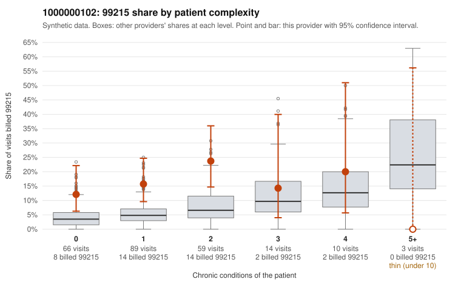

# 1000000102: 1000000102: too few returned records to judge

**Leaning (advisory):** Inconclusive

## Why

1000000102 billed 99215 on 16.6% of 241 claims against an expected 5.2% given patient complexity (risk-adjusted score 2.83; plain z-score vs peers 1.42). 55% of this provider's 99215 claims were on patients with 0 or 1 chronic conditions. Records came back for 30 claims. Of 7 documented 99215 claims, 3 (43%) were documented below the billed level, against 28% for the comparison providers. Note checks on 30 returned notes (share showing each sign): problems 30%, late 3%, unsigned 0%, data 3%. No audit trail was received. 1 of 19 notes claiming moderate-or-higher data reviewed had no lab or test line on the claim. The evidence does not support a call either way yet. Examples: C0062567: billed 99215, patient aged 36 with 1 chronic condition(s) (type 2 diabetes); documented MDM level moderate, minutes not recorded. C0062612: billed 99215; documented MDM level moderate, minutes not recorded. C0062481: billed 99215, patient aged 57 with 1 chronic condition(s) (asthma). C0062483: billed 99215, patient aged 70 with 1 chronic condition(s) (type 2 diabetes).

## Evidence chart

## Cited claims

`C0062567`, `C0062612`, `C0062481`, `C0062483`

## Suggested next steps

- 30 charts came back but do not settle it: request a targeted sample of 99215 charts, starting with C0062567, C0062612, C0062481.
- Re-check after the targeted charts arrive; do not call upcoding or a sicker panel on this evidence alone.

---
Citations checked: 4/4 valid. Synthetic data. The leaning is advisory; the flag comes from the statistical screen, and no clinical documentation is available beyond the sampled records-review facts shown in the packet.
