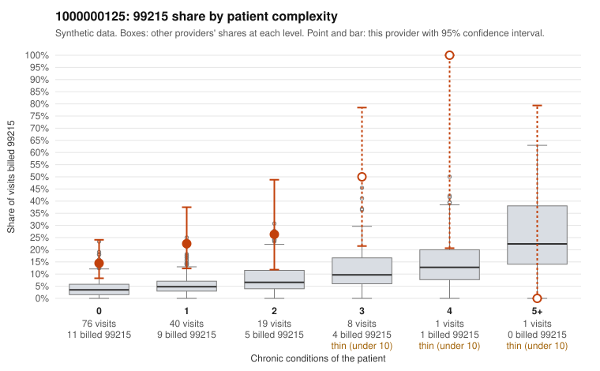

# 1000000125: 1000000125: too few returned records to judge

**Leaning (advisory):** Inconclusive

## Why

1000000125 billed 99215 on 20.7% of 145 claims against an expected 4.3% given patient complexity (risk-adjusted score 3.44; plain z-score vs peers 2.09). 67% of this provider's 99215 claims were on patients with 0 or 1 chronic conditions. Records came back for 30 claims. Of 6 documented 99215 claims, 0 (0%) were documented below the billed level, against 28% for the comparison providers. Note checks on 30 returned notes (share showing each sign): problems 63%, late 7%, unsigned 0%, data 10%, bulk created 0%, paste heavy 0%. 3 of 23 notes claiming moderate-or-higher data reviewed had no lab or test line on the claim. The evidence does not support a call either way yet. Examples: C0073736: billed 99213; documented MDM level straightforward, minutes not recorded. C0073857: billed 99214; documented MDM level low, 22 minutes. C0073708: billed 99215, patient aged 44 with 0 chronic condition(s); documented MDM level high, 45 minutes. C0073719: billed 99215, patient aged 27 with 1 chronic condition(s) (hyperlipidemia); documented MDM level high, 46 minutes.

## Evidence chart

## Cited claims

`C0073736`, `C0073857`, `C0073708`, `C0073719`

## Suggested next steps

- 30 charts came back but do not settle it: request a targeted sample of 99215 charts, starting with C0073736, C0073857, C0073708.
- Re-check after the targeted charts arrive; do not call upcoding or a sicker panel on this evidence alone.

---
Citations checked: 4/4 valid. Synthetic data. The leaning is advisory; the flag comes from the statistical screen, and no clinical documentation is available beyond the sampled records-review facts shown in the packet.
