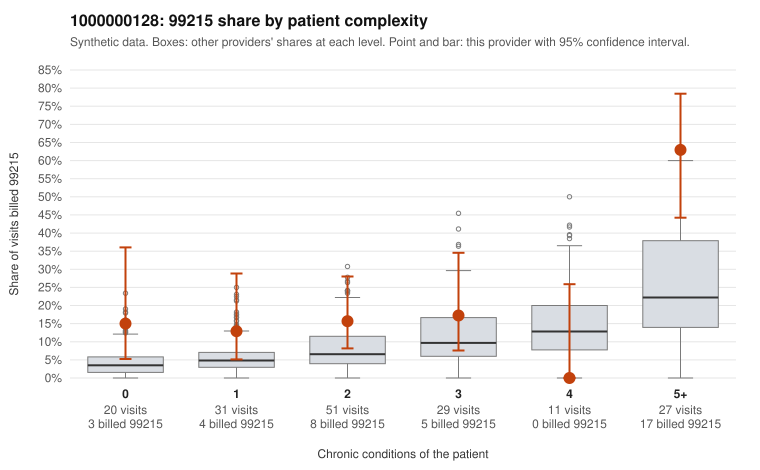

# 1000000128: 1000000128: documented 99215 claims mostly support the level billed (0% below)

**Leaning (advisory):** Pattern consistent with a high-acuity panel

## Why

1000000128 billed 99215 on 21.9% of 169 claims against an expected 8.2% given patient complexity (risk-adjusted score 2.30; plain z-score vs peers 2.29). 19% of this provider's 99215 claims were on patients with 0 or 1 chronic conditions. Records came back for 30 claims. Of 8 documented 99215 claims, 0 (0%) were documented below the billed level, against 28% for the comparison providers. Note checks on 30 returned notes (share showing each sign): problems 20%, late 0%, unsigned 0%, data 7%. No audit trail was received. 3 of 22 notes claiming moderate-or-higher data reviewed had no lab or test line on the claim. This pattern is consistent with a high-acuity panel. The sampled documentation supports the billed level. Examples: C0074424: billed 99215, patient aged 49 with 5 chronic condition(s) (hyperlipidemia;depression;atrial fibrillation;heart failure;COPD); documented MDM level high, minutes not recorded. C0074476: billed 99215; documented MDM level high, 49 minutes. C0074504: billed 99215, patient aged 50 with 1 chronic condition(s) (hyperlipidemia); documented MDM level high, 44 minutes. C0074427: billed 99215, patient aged 82 with 5 chronic condition(s) (obesity;hyperlipidemia;depression;hypertension;osteoarthritis).

## Evidence chart

## Cited claims

`C0074424`, `C0074476`, `C0074504`, `C0074427`

## Suggested next steps

- Do not pursue recovery on this evidence: 30 charts came back and they support the level billed (0 of 8 documented 99215 claims below the billed level).
- Revisit if the 99215 share keeps rising against peers or a larger sample shows unsupported claims.

---
Citations checked: 4/4 valid. Synthetic data. The leaning is advisory; the flag comes from the statistical screen, and no clinical documentation is available beyond the sampled records-review facts shown in the packet.
