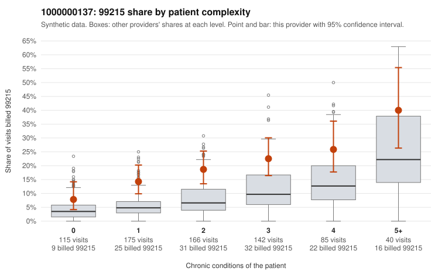

# 1000000137: 1000000137: too few returned records to judge

**Leaning (advisory):** Inconclusive

## Why

1000000137 billed 99215 on 18.7% of 723 claims against an expected 6.9% given patient complexity (risk-adjusted score 4.49; plain z-score vs peers 1.76). 25% of this provider's 99215 claims were on patients with 0 or 1 chronic conditions. Records came back for 30 claims. Of 11 documented 99215 claims, 3 (27%) were documented below the billed level, against 28% for the comparison providers. Note checks on 30 returned notes (share showing each sign): problems 23%, late 3%, unsigned 0%, data 3%. No audit trail was received. 2 of 21 notes claiming moderate-or-higher data reviewed had no lab or test line on the claim. The evidence does not support a call either way yet. Examples: C0082448: billed 99215, patient aged 89 with 4 chronic condition(s) (type 2 diabetes;obesity;hypertension;atrial fibrillation); documented MDM level moderate, minutes not recorded. C0082788: billed 99215; documented MDM level moderate, 36 minutes. C0082218: billed 99215, patient aged 55 with 1 chronic condition(s) (hypothyroidism). C0082229: billed 99215, patient aged 47 with 1 chronic condition(s) (atrial fibrillation).

## Evidence chart

## Cited claims

`C0082448`, `C0082788`, `C0082218`, `C0082229`

## Suggested next steps

- 30 charts came back but do not settle it: request a targeted sample of 99215 charts, starting with C0082448, C0082788, C0082218.
- Re-check after the targeted charts arrive; do not call upcoding or a sicker panel on this evidence alone.

---
Citations checked: 4/4 valid. Synthetic data. The leaning is advisory; the flag comes from the statistical screen, and no clinical documentation is available beyond the sampled records-review facts shown in the packet.
