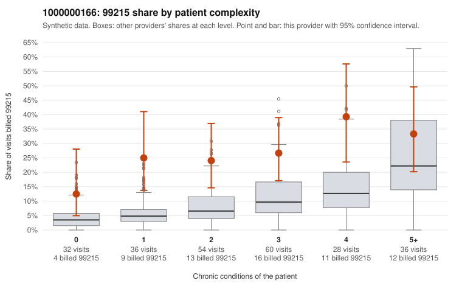

# 1000000166: 1000000166: 0 of 10 documented 99215 claims (0%) are documented below the billed level

**Leaning (advisory):** Pattern consistent with upcoding

## Why

1000000166 billed 99215 on 26.4% of 246 claims against an expected 8.4% given patient complexity (risk-adjusted score 3.67; plain z-score vs peers 3.04). 20% of this provider's 99215 claims were on patients with 0 or 1 chronic conditions. Records came back for 30 claims. Of 10 documented 99215 claims, 0 (0%) were documented below the billed level, against 28% for the comparison providers. Note checks on 30 returned notes (share showing each sign): problems 10%, late 13%, unsigned 0%, data 3%. No audit trail was received. 1 of 22 notes claiming moderate-or-higher data reviewed had no lab or test line on the claim. This pattern is consistent with upcoding. It is a reason to review the records, not a finding. Examples: C0103158: billed 99214; documented MDM level low, minutes not recorded. C0102963: billed 99215, patient aged 31 with 1 chronic condition(s) (COPD). C0102975: billed 99215, patient aged 54 with 0 chronic condition(s). C0102980: billed 99215, patient aged 38 with 0 chronic condition(s).

## Evidence chart

## Cited claims

`C0103158`, `C0102963`, `C0102975`, `C0102980`

## Suggested next steps

- Request the full charts for C0103158, C0102963, C0102975 and have a certified coder re-score each against the current E/M rules (medical decision making or total time).
- If the re-scoring confirms the pattern, review the random sample in the recovery packet's sampling plan before any overpayment estimate; do not extrapolate from a targeted sample.
- Look at the notes themselves: 10% address fewer problems than their level implies and 13% were signed late; request the audit trail for C0103158, C0102963, C0102975.

---
Citations checked: 4/4 valid. Synthetic data. The leaning is advisory; the flag comes from the statistical screen, and no clinical documentation is available beyond the sampled records-review facts shown in the packet.
