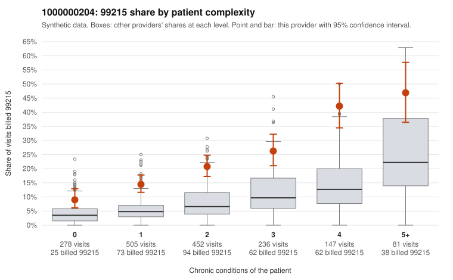

# 1000000204: 1000000204: too few returned records to judge

**Leaning (advisory):** Inconclusive

## Why

1000000204 billed 99215 on 20.8% of 1,699 claims against an expected 6.4% given patient complexity (risk-adjusted score 8.83; plain z-score vs peers 2.12). 28% of this provider's 99215 claims were on patients with 0 or 1 chronic conditions. Records came back for 30 claims. Of 6 documented 99215 claims, 1 (17%) were documented below the billed level, against 28% for the comparison providers. Note checks on 30 returned notes (share showing each sign): problems 20%, late 3%, unsigned 0%, data 0%. No audit trail was received. 0 of 24 notes claiming moderate-or-higher data reviewed had no lab or test line on the claim. The evidence does not support a call either way yet. Examples: C0123598: billed 99215; documented MDM level moderate, 30 minutes. C0123369: billed 99215, patient aged 48 with 1 chronic condition(s) (type 2 diabetes). C0123370: billed 99215, patient aged 45 with 1 chronic condition(s) (obesity).

## Evidence chart

## Cited claims

`C0123598`, `C0123369`, `C0123370`

## Suggested next steps

- 30 charts came back but do not settle it: request a targeted sample of 99215 charts, starting with C0123598, C0123369, C0123370.
- Re-check after the targeted charts arrive; do not call upcoding or a sicker panel on this evidence alone.

---
Citations checked: 3/3 valid. Synthetic data. The leaning is advisory; the flag comes from the statistical screen, and no clinical documentation is available beyond the sampled records-review facts shown in the packet.
