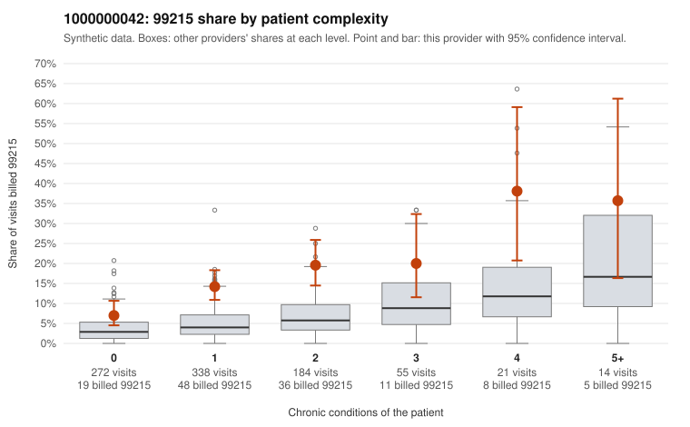

# 1000000042: 1000000042: too few returned records to judge

**Leaning (advisory):** Inconclusive

## Why

1000000042 billed 99215 on 14.4% of 884 claims against an expected 4.2% given patient complexity (risk-adjusted score 6.00; plain z-score vs peers 1.70). 53% of this provider's 99215 claims were on patients with 0 or 1 chronic conditions. Records came back for 30 claims. Of 5 documented 99215 claims, 1 (20%) were documented below the billed level, against 47% for the comparison providers. Note checks on 30 returned notes (share showing each sign): problems 43%, late 0%, unsigned 0%, data 10%, bulk created 0%, paste heavy 0%. 3 of 23 notes claiming moderate-or-higher data reviewed had no lab or test line on the claim. The evidence does not support a call either way yet. Examples: C0019663: billed 99215; documented MDM level moderate, 22 minutes. C0019305: billed 99215, patient aged 61 with 0 chronic condition(s). C0019320: billed 99215, patient aged 43 with 0 chronic condition(s).

## Evidence chart

## Cited claims

`C0019663`, `C0019305`, `C0019320`

## Suggested next steps

- 30 charts came back but do not settle it: request a targeted sample of 99215 charts, starting with C0019663, C0019305, C0019320.
- Re-check after the targeted charts arrive; do not call upcoding or a sicker panel on this evidence alone.

---
Citations checked: 3/3 valid. Synthetic data. The leaning is advisory; the flag comes from the statistical screen, and no clinical documentation is available beyond the sampled records-review facts shown in the packet.
