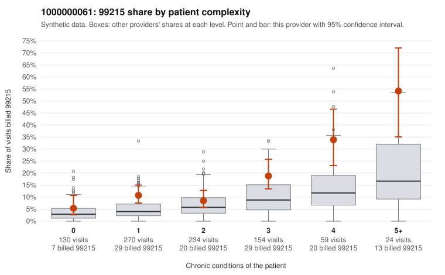

# 1000000061: 1000000061: too few returned records to judge

**Leaning (advisory):** Inconclusive

## Why

1000000061 billed 99215 on 13.5% of 871 claims against an expected 5.3% given patient complexity (risk-adjusted score 4.30; plain z-score vs peers 1.52). 31% of this provider's 99215 claims were on patients with 0 or 1 chronic conditions. Records came back for 30 claims. Of 2 documented 99215 claims, 0 (0%) were documented below the billed level, against 47% for the comparison providers. Note checks on 30 returned notes (share showing each sign): problems 13%, late 0%, unsigned 0%, data 7%. No audit trail was received. 3 of 20 notes claiming moderate-or-higher data reviewed had no lab or test line on the claim. The evidence does not support a call either way yet. Examples: C0032341: billed 99213; documented MDM level straightforward, minutes not recorded. C0031590: billed 99215, patient aged 40 with 1 chronic condition(s) (hyperlipidemia). C0031594: billed 99215, patient aged 45 with 0 chronic condition(s).

## Evidence chart

## Cited claims

`C0032341`, `C0031590`, `C0031594`

## Suggested next steps

- 30 charts came back but do not settle it: request a targeted sample of 99215 charts, starting with C0032341, C0031590, C0031594.
- Re-check after the targeted charts arrive; do not call upcoding or a sicker panel on this evidence alone.

---
Citations checked: 3/3 valid. Synthetic data. The leaning is advisory; the flag comes from the statistical screen, and no clinical documentation is available beyond the sampled records-review facts shown in the packet.
