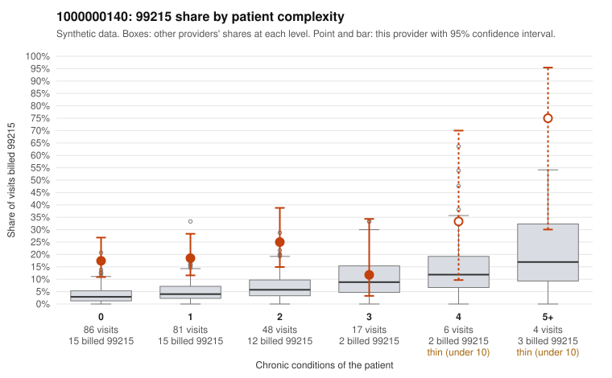

# 1000000140: 1000000140: 1 of 21 documented 99215 claims (5%) are documented below the billed level

**Leaning (advisory):** Pattern consistent with upcoding

## Why

1000000140 billed 99215 on 20.2% of 242 claims against an expected 4.2% given patient complexity (risk-adjusted score 4.96; plain z-score vs peers 3.02). 61% of this provider's 99215 claims were on patients with 0 or 1 chronic conditions. Records came back for 45 claims. Of 21 documented 99215 claims, 1 (5%) were documented below the billed level, against 47% for the comparison providers. Note checks on 45 returned notes (share showing each sign): problems 42%, late 13%, unsigned 0%, data 7%. No audit trail was received. 4 of 40 notes claiming moderate-or-higher data reviewed had no lab or test line on the claim. This pattern is consistent with upcoding. It is a reason to review the records, not a finding. Examples: C0063092: billed 99215, patient aged 56 with 4 chronic condition(s) (type 2 diabetes;hyperlipidemia;hypertension;COPD); documented MDM level moderate, minutes not recorded. C0062994: billed 99215, patient aged 43 with 1 chronic condition(s) (chronic kidney disease). C0062997: billed 99215, patient aged 50 with 1 chronic condition(s) (type 2 diabetes). C0063011: billed 99215, patient aged 31 with 0 chronic condition(s).

## Evidence chart

## Cited claims

`C0063092`, `C0062994`, `C0062997`, `C0063011`

## Suggested next steps

- Request the full charts for C0063092, C0062994, C0062997 and have a certified coder re-score each against the current E/M rules (medical decision making or total time).
- If the re-scoring confirms the pattern, review the random sample in the recovery packet's sampling plan before any overpayment estimate; do not extrapolate from a targeted sample.
- Look at the notes themselves: 42% address fewer problems than their level implies and 13% were signed late; request the audit trail for C0063092, C0062994, C0062997.

---
Citations checked: 4/4 valid. Synthetic data. The leaning is advisory; the flag comes from the statistical screen, and no clinical documentation is available beyond the sampled records-review facts shown in the packet.
