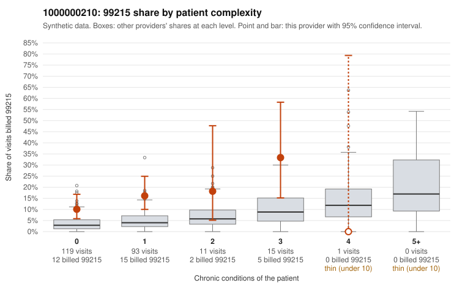

# 1000000210: 1000000210: 0 of 14 documented 99214 and 99215 claims (0%) are documented below the billed level

**Leaning (advisory):** Pattern consistent with upcoding

## Why

1000000210 billed 99215 on 14.2% of 239 claims against an expected 3.5% given patient complexity (risk-adjusted score 3.55; plain z-score vs peers 1.67). 79% of this provider's 99215 claims were on patients with 0 or 1 chronic conditions. Records came back for 29 claims. Of 5 documented 99215 claims, 0 (0%) were documented below the billed level, against 47% for the comparison providers. Note checks on 29 returned notes (share showing each sign): problems 45%, late 21%, unsigned 0%, data 21%, bulk created 10%, paste heavy 17%. 6 of 20 notes claiming moderate-or-higher data reviewed had no lab or test line on the claim. This pattern is consistent with upcoding. It is a reason to review the records, not a finding. Examples: C0106383: billed 99215, patient aged 40 with 0 chronic condition(s). C0106384: billed 99215, patient aged 57 with 0 chronic condition(s). C0106388: billed 99215, patient aged 18 with 1 chronic condition(s) (hyperlipidemia).

## Evidence chart

## Cited claims

`C0106383`, `C0106384`, `C0106388`

## Suggested next steps

- Request the full charts for C0106383, C0106384, C0106388 and have a certified coder re-score each against the current E/M rules (medical decision making or total time).
- If the re-scoring confirms the pattern, review the random sample in the recovery packet's sampling plan before any overpayment estimate; do not extrapolate from a targeted sample.
- Look at the notes themselves: 45% address fewer problems than their level implies and 21% were signed late; request the audit trail for C0106383, C0106384, C0106388.

---
Citations checked: 3/3 valid. Synthetic data. The leaning is advisory; the flag comes from the statistical screen, and no clinical documentation is available beyond the sampled records-review facts shown in the packet.
