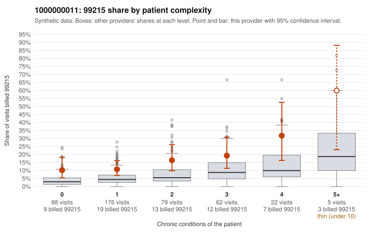

# 1000000011: 1000000011: too few returned records to judge

**Leaning (advisory):** Inconclusive

## Why

1000000011 billed 99215 on 14.6% of 432 claims against an expected 5.0% given patient complexity (risk-adjusted score 3.19; plain z-score vs peers 1.22). 44% of this provider's 99215 claims were on patients with 0 or 1 chronic conditions. Records came back for 16 claims. Of 1 documented 99215 claims, 0 (0%) were documented below the billed level, against 58% for the comparison providers. Note checks on 16 returned notes (share showing each sign): problems 19%, late 0%, unsigned 0%, data 0%. No audit trail was received. 0 of 10 notes claiming moderate-or-higher data reviewed had no lab or test line on the claim. The evidence does not support a call either way yet. Examples: C0004267: billed 99214, patient aged 75 with 5 chronic condition(s) (hypothyroidism;hyperlipidemia;depression;hypertension;COPD); documented MDM level low, minutes not recorded. C0004043: billed 99215, patient aged 33 with 1 chronic condition(s) (hypothyroidism). C0004064: billed 99215, patient aged 47 with 1 chronic condition(s) (type 2 diabetes).

## Evidence chart

## Cited claims

`C0004267`, `C0004043`, `C0004064`

## Suggested next steps

- 16 charts came back but do not settle it: request a targeted sample of 99215 charts, starting with C0004267, C0004043, C0004064.
- Re-check after the targeted charts arrive; do not call upcoding or a sicker panel on this evidence alone.

---
Citations checked: 3/3 valid. Synthetic data. The leaning is advisory; the flag comes from the statistical screen, and no clinical documentation is available beyond the sampled records-review facts shown in the packet.
