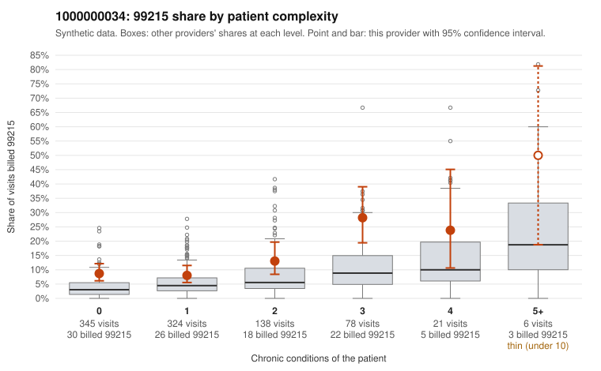

# 1000000034: 1000000034: too few returned records to judge

**Leaning (advisory):** Inconclusive

## Why

1000000034 billed 99215 on 11.4% of 912 claims against an expected 4.3% given patient complexity (risk-adjusted score 3.69; plain z-score vs peers 0.69). 54% of this provider's 99215 claims were on patients with 0 or 1 chronic conditions. Records came back for 30 claims. Of 4 documented 99215 claims, 0 (0%) were documented below the billed level, against 58% for the comparison providers. Note checks on 30 returned notes (share showing each sign): problems 27%, late 3%, unsigned 0%, data 7%. No audit trail was received. 3 of 24 notes claiming moderate-or-higher data reviewed had no lab or test line on the claim. The evidence does not support a call either way yet. Examples: C0014918: billed 99213; documented MDM level straightforward, minutes not recorded. C0014610: billed 99215, patient aged 69 with 1 chronic condition(s) (depression). C0014630: billed 99215, patient aged 57 with 0 chronic condition(s).

## Evidence chart

## Cited claims

`C0014918`, `C0014610`, `C0014630`

## Suggested next steps

- 30 charts came back but do not settle it: request a targeted sample of 99215 charts, starting with C0014918, C0014610, C0014630.
- Re-check after the targeted charts arrive; do not call upcoding or a sicker panel on this evidence alone.

---
Citations checked: 3/3 valid. Synthetic data. The leaning is advisory; the flag comes from the statistical screen, and no clinical documentation is available beyond the sampled records-review facts shown in the packet.
