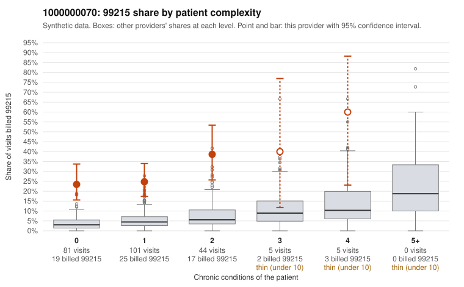

# 1000000070: 1000000070: too few returned records to judge

**Leaning (advisory):** Inconclusive

## Why

1000000070 billed 99215 on 28.0% of 236 claims against an expected 4.1% given patient complexity (risk-adjusted score 6.61; plain z-score vs peers 3.47). 67% of this provider's 99215 claims were on patients with 0 or 1 chronic conditions. Records came back for 30 claims. Of 6 documented 99215 claims, 5 (83%) were documented below the billed level, against 58% for the comparison providers. Note checks on 30 returned notes (share showing each sign): problems 30%, late 10%, unsigned 0%, data 0%. No audit trail was received. 3 of 13 notes claiming moderate-or-higher data reviewed had no lab or test line on the claim. The evidence does not support a call either way yet. Examples: C0030082: billed 99215, patient aged 54 with 0 chronic condition(s); documented MDM level moderate, 38 minutes. C0030102: billed 99215; documented MDM level moderate, 39 minutes. C0030014: billed 99215, patient aged 53 with 0 chronic condition(s). C0030016: billed 99215, patient aged 51 with 1 chronic condition(s) (hyperlipidemia).

## Evidence chart

## Cited claims

`C0030082`, `C0030102`, `C0030014`, `C0030016`

## Suggested next steps

- 30 charts came back but do not settle it: request a targeted sample of 99215 charts, starting with C0030082, C0030102, C0030014.
- Re-check after the targeted charts arrive; do not call upcoding or a sicker panel on this evidence alone.

---
Citations checked: 4/4 valid. Synthetic data. The leaning is advisory; the flag comes from the statistical screen, and no clinical documentation is available beyond the sampled records-review facts shown in the packet.
