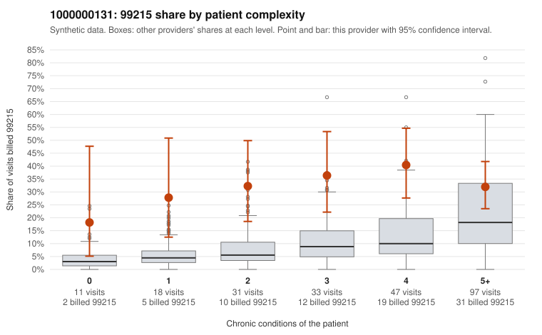

# 1000000131: 1000000131: documented 99215 claims mostly support the level billed (0% below)

**Leaning (advisory):** Pattern consistent with a high-acuity panel

## Why

1000000131 billed 99215 on 33.3% of 237 claims against an expected 11.4% given patient complexity (risk-adjusted score 3.78; plain z-score vs peers 4.38). 9% of this provider's 99215 claims were on patients with 0 or 1 chronic conditions. Records came back for 30 claims. Of 9 documented 99215 claims, 0 (0%) were documented below the billed level, against 58% for the comparison providers. Note checks on 30 returned notes (share showing each sign): problems 10%, late 20%, unsigned 0%, data 13%, bulk created 3%, paste heavy 3%. 4 of 24 notes claiming moderate-or-higher data reviewed had no lab or test line on the claim. This pattern is consistent with a high-acuity panel. The sampled documentation supports the billed level. Examples: C0066826: billed 99215; documented MDM level high, 45 minutes. C0066833: billed 99215, patient aged 34 with 1 chronic condition(s) (type 2 diabetes); documented MDM level high, minutes not recorded. C0066952: billed 99215; documented MDM level high, minutes not recorded. C0066763: billed 99215, patient aged 54 with 4 chronic condition(s) (type 2 diabetes;hyperlipidemia;hypertension;heart failure). C0066770: billed 99215, patient aged 51 with 4 chronic condition(s) (type 2 diabetes;hyperlipidemia;hypertension;chronic kidney disease).

## Evidence chart

## Cited claims

`C0066826`, `C0066833`, `C0066952`, `C0066763`, `C0066770`

## Suggested next steps

- Do not pursue recovery on this evidence: 30 charts came back and they support the level billed (0 of 9 documented 99215 claims below the billed level).
- Revisit if the 99215 share keeps rising against peers or a larger sample shows unsupported claims.

---
Citations checked: 5/5 valid. Synthetic data. The leaning is advisory; the flag comes from the statistical screen, and no clinical documentation is available beyond the sampled records-review facts shown in the packet.
