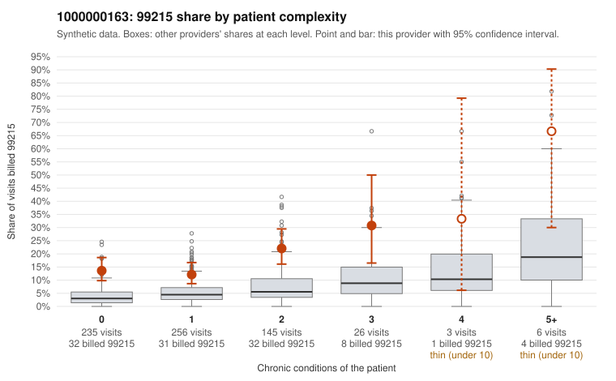

# 1000000163: 1000000163: too few returned records to judge

**Leaning (advisory):** Inconclusive

## Why

1000000163 billed 99215 on 16.1% of 671 claims against an expected 4.2% given patient complexity (risk-adjusted score 5.46; plain z-score vs peers 1.48). 58% of this provider's 99215 claims were on patients with 0 or 1 chronic conditions. Records came back for 30 claims. Of 5 documented 99215 claims, 2 (40%) were documented below the billed level, against 58% for the comparison providers. Note checks on 30 returned notes (share showing each sign): problems 47%, late 3%, unsigned 0%, data 0%. No audit trail was received. 0 of 21 notes claiming moderate-or-higher data reviewed had no lab or test line on the claim. The evidence does not support a call either way yet. Examples: C0086497: billed 99215, patient aged 20 with 0 chronic condition(s); documented MDM level moderate, 31 minutes. C0086502: billed 99215; documented MDM level moderate, 30 minutes. C0086133: billed 99215, patient aged 60 with 0 chronic condition(s). C0086167: billed 99215, patient aged 59 with 0 chronic condition(s).

## Evidence chart

## Cited claims

`C0086497`, `C0086502`, `C0086133`, `C0086167`

## Suggested next steps

- 30 charts came back but do not settle it: request a targeted sample of 99215 charts, starting with C0086497, C0086502, C0086133.
- Re-check after the targeted charts arrive; do not call upcoding or a sicker panel on this evidence alone.

---
Citations checked: 4/4 valid. Synthetic data. The leaning is advisory; the flag comes from the statistical screen, and no clinical documentation is available beyond the sampled records-review facts shown in the packet.
