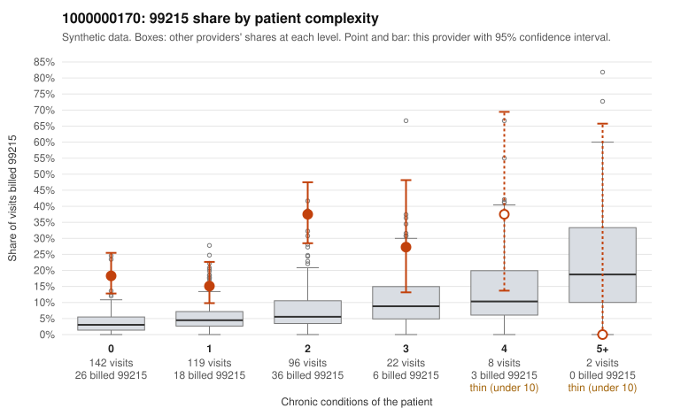

# 1000000170: 1000000170: too few returned records to judge

**Leaning (advisory):** Inconclusive

## Why

1000000170 billed 99215 on 22.9% of 389 claims against an expected 4.4% given patient complexity (risk-adjusted score 6.39; plain z-score vs peers 2.62). 49% of this provider's 99215 claims were on patients with 0 or 1 chronic conditions. Records came back for 30 claims. Of 4 documented 99215 claims, 1 (25%) were documented below the billed level, against 58% for the comparison providers. Note checks on 30 returned notes (share showing each sign): problems 43%, late 3%, unsigned 0%, data 13%, bulk created 0%, paste heavy 7%. 4 of 21 notes claiming moderate-or-higher data reviewed had no lab or test line on the claim. The evidence does not support a call either way yet. Examples: C0089849: billed 99215; documented MDM level moderate, 36 minutes. C0089725: billed 99215, patient aged 51 with 1 chronic condition(s) (hypertension). C0089737: billed 99215, patient aged 28 with 1 chronic condition(s) (hypothyroidism).

## Evidence chart

## Cited claims

`C0089849`, `C0089725`, `C0089737`

## Suggested next steps

- 30 charts came back but do not settle it: request a targeted sample of 99215 charts, starting with C0089849, C0089725, C0089737.
- Re-check after the targeted charts arrive; do not call upcoding or a sicker panel on this evidence alone.

---
Citations checked: 3/3 valid. Synthetic data. The leaning is advisory; the flag comes from the statistical screen, and no clinical documentation is available beyond the sampled records-review facts shown in the packet.
