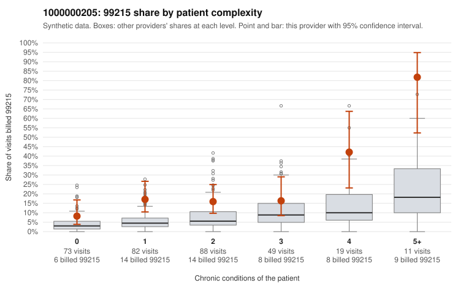

# 1000000205: 1000000205: too few returned records to judge

**Leaning (advisory):** Inconclusive

## Why

1000000205 billed 99215 on 18.3% of 322 claims against an expected 5.5% given patient complexity (risk-adjusted score 3.55; plain z-score vs peers 1.85). 34% of this provider's 99215 claims were on patients with 0 or 1 chronic conditions. Records came back for 29 claims. Of 7 documented 99215 claims, 1 (14%) were documented below the billed level, against 58% for the comparison providers. Note checks on 29 returned notes (share showing each sign): problems 28%, late 0%, unsigned 0%, data 3%. No audit trail was received. 1 of 18 notes claiming moderate-or-higher data reviewed had no lab or test line on the claim. The evidence does not support a call either way yet. Examples: C0112782: billed 99215, patient aged 41 with 1 chronic condition(s) (depression); documented MDM level moderate, 36 minutes. C0112586: billed 99215, patient aged 62 with 1 chronic condition(s) (hypertension). C0112624: billed 99215, patient aged 58 with 1 chronic condition(s) (COPD).

## Evidence chart

## Cited claims

`C0112782`, `C0112586`, `C0112624`

## Suggested next steps

- 29 charts came back but do not settle it: request a targeted sample of 99215 charts, starting with C0112782, C0112586, C0112624.
- Re-check after the targeted charts arrive; do not call upcoding or a sicker panel on this evidence alone.

---
Citations checked: 3/3 valid. Synthetic data. The leaning is advisory; the flag comes from the statistical screen, and no clinical documentation is available beyond the sampled records-review facts shown in the packet.
