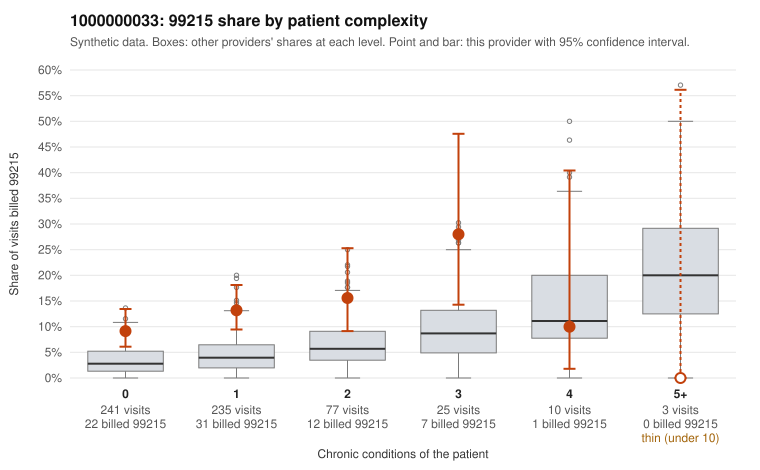

# 1000000033: 1000000033: 16 of 21 documented 99215 claims (76%) are documented below the billed level

**Leaning (advisory):** Pattern consistent with upcoding

## Why

1000000033 billed 99215 on 12.4% of 591 claims against an expected 3.8% given patient complexity (risk-adjusted score 4.91; plain z-score vs peers 1.27). 73% of this provider's 99215 claims were on patients with 0 or 1 chronic conditions. Records came back for 45 claims. Of 21 documented 99215 claims, 16 (76%) were documented below the billed level, against 30% for the comparison providers. Note checks on 45 returned notes (share showing each sign): problems 24%, late 2%, unsigned 0%, data 2%. No audit trail was received. 3 of 29 notes claiming moderate-or-higher data reviewed had no lab or test line on the claim. This pattern is consistent with upcoding. It is a reason to review the records, not a finding. Examples: C0018122: billed 99215; documented MDM level moderate, 32 minutes. C0018279: billed 99215; documented MDM level moderate, 35 minutes. C0018287: billed 99215; documented MDM level moderate, 33 minutes. C0017696: billed 99215, patient aged 72 with 1 chronic condition(s) (chronic kidney disease). C0017720: billed 99215, patient aged 50 with 0 chronic condition(s). C0017734: billed 99215, patient aged 27 with 0 chronic condition(s).

## Evidence chart

## Cited claims

`C0018122`, `C0018279`, `C0018287`, `C0017696`, `C0017720`, `C0017734`

## Suggested next steps

- Request the full charts for C0018122, C0018279, C0018287 and have a certified coder re-score each against the current E/M rules (medical decision making or total time).
- If the re-scoring confirms the pattern, review the random sample in the recovery packet's sampling plan before any overpayment estimate; do not extrapolate from a targeted sample.
- Look at the notes themselves: 24% address fewer problems than their level implies and 2% were signed late; request the audit trail for C0018122, C0018279, C0018287.

---
Citations checked: 6/6 valid. Synthetic data. The leaning is advisory; the flag comes from the statistical screen, and no clinical documentation is available beyond the sampled records-review facts shown in the packet.
