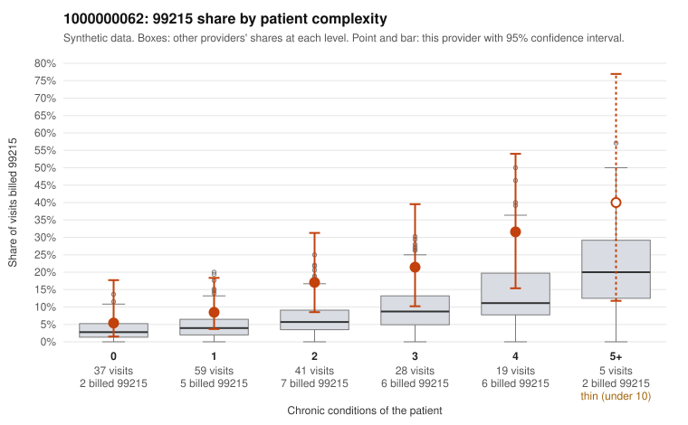

# 1000000062: 1000000062: too few returned records to judge

**Leaning (advisory):** Inconclusive

## Why

1000000062 billed 99215 on 14.8% of 189 claims against an expected 5.4% given patient complexity (risk-adjusted score 2.52; plain z-score vs peers 1.80). 25% of this provider's 99215 claims were on patients with 0 or 1 chronic conditions. Records came back for 30 claims. Of 2 documented 99215 claims, 0 (0%) were documented below the billed level, against 30% for the comparison providers. Note checks on 30 returned notes (share showing each sign): problems 23%, late 7%, unsigned 0%, data 3%. No audit trail was received. 3 of 21 notes claiming moderate-or-higher data reviewed had no lab or test line on the claim. The evidence does not support a call either way yet. Examples: C0032949: billed 99214; documented MDM level low, 26 minutes. C0032878: billed 99215, patient aged 26 with 0 chronic condition(s). C0032939: billed 99215, patient aged 52 with 1 chronic condition(s) (chronic kidney disease); documented MDM level high, 44 minutes.

## Evidence chart

## Cited claims

`C0032949`, `C0032878`, `C0032939`

## Suggested next steps

- 30 charts came back but do not settle it: request a targeted sample of 99215 charts, starting with C0032949, C0032878, C0032939.
- Re-check after the targeted charts arrive; do not call upcoding or a sicker panel on this evidence alone.

---
Citations checked: 3/3 valid. Synthetic data. The leaning is advisory; the flag comes from the statistical screen, and no clinical documentation is available beyond the sampled records-review facts shown in the packet.
