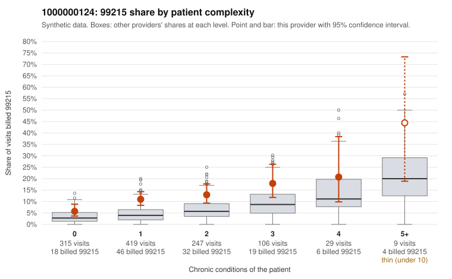

# 1000000124: 1000000124: too few returned records to judge

**Leaning (advisory):** Inconclusive

## Why

1000000124 billed 99215 on 11.1% of 1,125 claims against an expected 4.3% given patient complexity (risk-adjusted score 5.01; plain z-score vs peers 1.01). 51% of this provider's 99215 claims were on patients with 0 or 1 chronic conditions. Records came back for 29 claims. Of 3 documented 99215 claims, 0 (0%) were documented below the billed level, against 30% for the comparison providers. Note checks on 29 returned notes (share showing each sign): problems 31%, late 7%, unsigned 0%, data 3%. No audit trail was received. 1 of 19 notes claiming moderate-or-higher data reviewed had no lab or test line on the claim. The evidence does not support a call either way yet. Examples: C0068649: billed 99214; documented MDM level low, minutes not recorded. C0068497: billed 99215, patient aged 41 with 0 chronic condition(s). C0068506: billed 99215, patient aged 52 with 1 chronic condition(s) (obesity).

## Evidence chart

## Cited claims

`C0068649`, `C0068497`, `C0068506`

## Suggested next steps

- 29 charts came back but do not settle it: request a targeted sample of 99215 charts, starting with C0068649, C0068497, C0068506.
- Re-check after the targeted charts arrive; do not call upcoding or a sicker panel on this evidence alone.

---
Citations checked: 3/3 valid. Synthetic data. The leaning is advisory; the flag comes from the statistical screen, and no clinical documentation is available beyond the sampled records-review facts shown in the packet.
