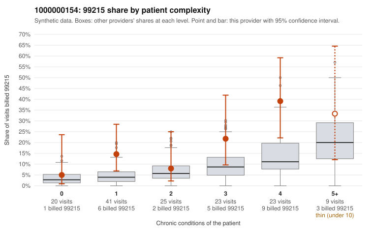

# 1000000154: 1000000154: too few returned records to judge

**Leaning (advisory):** Inconclusive

## Why

1000000154 billed 99215 on 18.4% of 141 claims against an expected 6.5% given patient complexity (risk-adjusted score 2.56; plain z-score vs peers 2.58). 27% of this provider's 99215 claims were on patients with 0 or 1 chronic conditions. Records came back for 30 claims. Of 6 documented 99215 claims, 2 (33%) were documented below the billed level, against 30% for the comparison providers. Note checks on 30 returned notes (share showing each sign): problems 23%, late 10%, unsigned 0%, data 0%. No audit trail was received. 2 of 21 notes claiming moderate-or-higher data reviewed had no lab or test line on the claim. The evidence does not support a call either way yet. Examples: C0091172: billed 99215, patient aged 31 with 1 chronic condition(s) (atrial fibrillation); documented MDM level moderate, 34 minutes. C0091258: billed 99215, patient aged 34 with 1 chronic condition(s) (osteoarthritis); documented MDM level moderate, 34 minutes. C0091174: billed 99215, patient aged 19 with 1 chronic condition(s) (hyperlipidemia).

## Evidence chart

## Cited claims

`C0091172`, `C0091258`, `C0091174`

## Suggested next steps

- 30 charts came back but do not settle it: request a targeted sample of 99215 charts, starting with C0091172, C0091258, C0091174.
- Re-check after the targeted charts arrive; do not call upcoding or a sicker panel on this evidence alone.

---
Citations checked: 3/3 valid. Synthetic data. The leaning is advisory; the flag comes from the statistical screen, and no clinical documentation is available beyond the sampled records-review facts shown in the packet.
