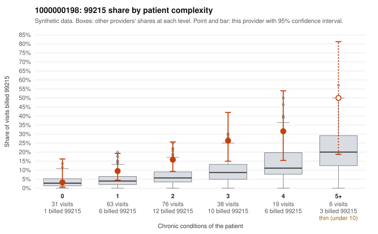

# 1000000198: 1000000198: too few returned records to judge

**Leaning (advisory):** Inconclusive

## Why

1000000198 billed 99215 on 16.3% of 233 claims against an expected 5.6% given patient complexity (risk-adjusted score 3.18; plain z-score vs peers 2.12). 18% of this provider's 99215 claims were on patients with 0 or 1 chronic conditions. Records came back for 30 claims. Of 7 documented 99215 claims, 3 (43%) were documented below the billed level, against 30% for the comparison providers. Note checks on 30 returned notes (share showing each sign): problems 20%, late 7%, unsigned 0%, data 3%. No audit trail was received. 2 of 25 notes claiming moderate-or-higher data reviewed had no lab or test line on the claim. The evidence does not support a call either way yet. Examples: C0116579: billed 99215, patient aged 29 with 1 chronic condition(s) (heart failure); documented MDM level moderate, 37 minutes. C0116584: billed 99215; documented MDM level moderate, 38 minutes. C0116523: billed 99215, patient aged 19 with 1 chronic condition(s) (type 2 diabetes); documented MDM level high, minutes not recorded. C0116546: billed 99215, patient aged 46 with 0 chronic condition(s).

## Evidence chart

## Cited claims

`C0116579`, `C0116584`, `C0116523`, `C0116546`

## Suggested next steps

- 30 charts came back but do not settle it: request a targeted sample of 99215 charts, starting with C0116579, C0116584, C0116523.
- Re-check after the targeted charts arrive; do not call upcoding or a sicker panel on this evidence alone.

---
Citations checked: 4/4 valid. Synthetic data. The leaning is advisory; the flag comes from the statistical screen, and no clinical documentation is available beyond the sampled records-review facts shown in the packet.
