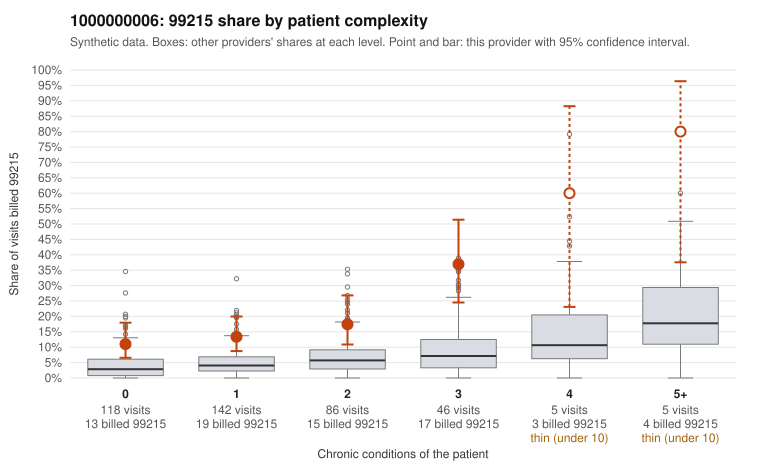

# 1000000006: 1000000006: too few returned records to judge

**Leaning (advisory):** Inconclusive

## Why

1000000006 billed 99215 on 17.7% of 402 claims against an expected 4.5% given patient complexity (risk-adjusted score 4.78; plain z-score vs peers 2.15). 45% of this provider's 99215 claims were on patients with 0 or 1 chronic conditions. Records came back for 45 claims. Of 18 documented 99215 claims, 5 (28%) were documented below the billed level, against 24% for the comparison providers. Note checks on 45 returned notes (share showing each sign): problems 20%, late 4%, unsigned 0%, data 4%. No audit trail was received. 4 of 36 notes claiming moderate-or-higher data reviewed had no lab or test line on the claim. The evidence does not support a call either way yet. Examples: C0003306: billed 99215; documented MDM level moderate, 28 minutes. C0003433: billed 99215, patient aged 62 with 0 chronic condition(s); documented MDM level moderate, minutes not recorded. C0003185: billed 99215, patient aged 44 with 0 chronic condition(s). C0003203: billed 99215, patient aged 54 with 1 chronic condition(s) (hyperlipidemia); documented MDM level high, 53 minutes.

## Evidence chart

## Cited claims

`C0003306`, `C0003433`, `C0003185`, `C0003203`

## Suggested next steps

- 45 charts came back but do not settle it: request a targeted sample of 99215 charts, starting with C0003306, C0003433, C0003185.
- Re-check after the targeted charts arrive; do not call upcoding or a sicker panel on this evidence alone.

---
Citations checked: 4/4 valid. Synthetic data. The leaning is advisory; the flag comes from the statistical screen, and no clinical documentation is available beyond the sampled records-review facts shown in the packet.
