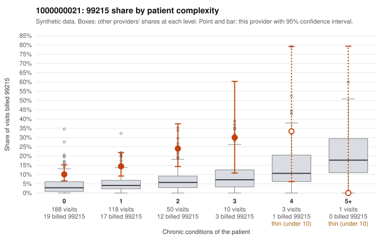

# 1000000021: 1000000021: too few returned records to judge

**Leaning (advisory):** Inconclusive

## Why

1000000021 billed 99215 on 14.1% of 370 claims against an expected 3.7% given patient complexity (risk-adjusted score 3.93; plain z-score vs peers 1.44). 69% of this provider's 99215 claims were on patients with 0 or 1 chronic conditions. Records came back for 30 claims. Of 5 documented 99215 claims, 2 (40%) were documented below the billed level, against 24% for the comparison providers. Note checks on 30 returned notes (share showing each sign): problems 43%, late 10%, unsigned 0%, data 10%. No audit trail was received. 3 of 20 notes claiming moderate-or-higher data reviewed had no lab or test line on the claim. The evidence does not support a call either way yet. Examples: C0012981: billed 99215, patient aged 43 with 1 chronic condition(s) (hypertension); documented MDM level moderate, minutes not recorded. C0013029: billed 99215, patient aged 69 with 1 chronic condition(s) (osteoarthritis); documented MDM level moderate, 34 minutes. C0012987: billed 99215, patient aged 31 with 0 chronic condition(s).

## Evidence chart

## Cited claims

`C0012981`, `C0013029`, `C0012987`

## Suggested next steps

- 30 charts came back but do not settle it: request a targeted sample of 99215 charts, starting with C0012981, C0013029, C0012987.
- Re-check after the targeted charts arrive; do not call upcoding or a sicker panel on this evidence alone.

---
Citations checked: 3/3 valid. Synthetic data. The leaning is advisory; the flag comes from the statistical screen, and no clinical documentation is available beyond the sampled records-review facts shown in the packet.
