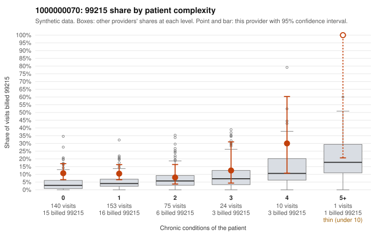

# 1000000070: 1000000070: too few returned records to judge

**Leaning (advisory):** Inconclusive

## Why

1000000070 billed 99215 on 10.9% of 403 claims against an expected 4.1% given patient complexity (risk-adjusted score 2.50; plain z-score vs peers 0.83). 70% of this provider's 99215 claims were on patients with 0 or 1 chronic conditions. Records came back for 29 claims. Of 3 documented 99215 claims, 0 (0%) were documented below the billed level, against 24% for the comparison providers. Note checks on 29 returned notes (share showing each sign): problems 34%, late 0%, unsigned 0%, data 10%. No audit trail was received. 4 of 19 notes claiming moderate-or-higher data reviewed had no lab or test line on the claim. The evidence does not support a call either way yet. Examples: C0031521: billed 99215, patient aged 51 with 0 chronic condition(s). C0031550: billed 99215, patient aged 28 with 0 chronic condition(s).

## Evidence chart

## Cited claims

`C0031521`, `C0031550`

## Suggested next steps

- 29 charts came back but do not settle it: request a targeted sample of 99215 charts, starting with C0031521, C0031550.
- Re-check after the targeted charts arrive; do not call upcoding or a sicker panel on this evidence alone.

---
Citations checked: 2/2 valid. Synthetic data. The leaning is advisory; the flag comes from the statistical screen, and no clinical documentation is available beyond the sampled records-review facts shown in the packet.
