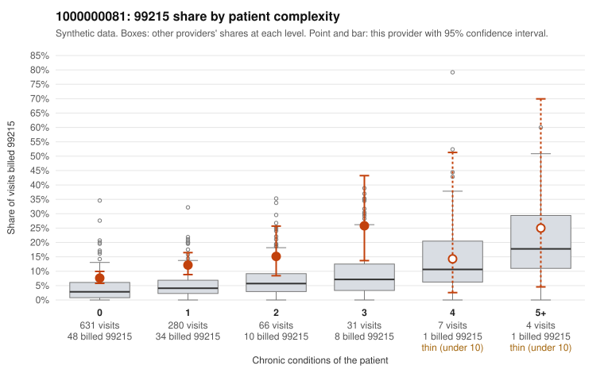

# 1000000081: 1000000081: 4 of 12 documented 99214 and 99215 claims (33%) are documented below the billed level

**Leaning (advisory):** Pattern consistent with upcoding

## Why

1000000081 billed 99215 on 10.0% of 1,019 claims against an expected 3.5% given patient complexity (risk-adjusted score 4.23; plain z-score vs peers 0.65). 80% of this provider's 99215 claims were on patients with 0 or 1 chronic conditions. Records came back for 30 claims. Of 1 documented 99215 claims, 1 (100%) were documented below the billed level, against 24% for the comparison providers. Note checks on 30 returned notes (share showing each sign): problems 17%, late 3%, unsigned 0%, data 3%. No audit trail was received. 3 of 10 notes claiming moderate-or-higher data reviewed had no lab or test line on the claim. This pattern is consistent with upcoding. It is a reason to review the records, not a finding. Examples: C0039060: billed 99215; documented MDM level moderate, 39 minutes. C0038144: billed 99215, patient aged 62 with 1 chronic condition(s) (hyperlipidemia). C0038164: billed 99215, patient aged 35 with 1 chronic condition(s) (hyperlipidemia). C0038216: billed 99215, patient aged 41 with 0 chronic condition(s).

## Evidence chart

## Cited claims

`C0039060`, `C0038144`, `C0038164`, `C0038216`

## Suggested next steps

- Request the full charts for C0039060, C0038144, C0038164 and have a certified coder re-score each against the current E/M rules (medical decision making or total time).
- If the re-scoring confirms the pattern, review the random sample in the recovery packet's sampling plan before any overpayment estimate; do not extrapolate from a targeted sample.
- Look at the notes themselves: 17% address fewer problems than their level implies and 3% were signed late; request the audit trail for C0039060, C0038144, C0038164.

---
Citations checked: 4/4 valid. Synthetic data. The leaning is advisory; the flag comes from the statistical screen, and no clinical documentation is available beyond the sampled records-review facts shown in the packet.
