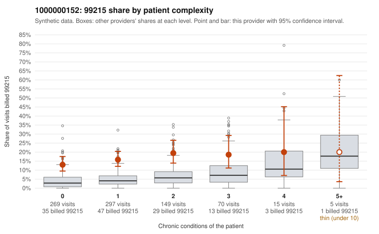

# 1000000152: 1000000152: 14 of 16 documented 99215 claims (88%) are documented below the billed level

**Leaning (advisory):** Pattern consistent with upcoding

## Why

1000000152 billed 99215 on 15.9% of 805 claims against an expected 4.3% given patient complexity (risk-adjusted score 6.14; plain z-score vs peers 1.80). 64% of this provider's 99215 claims were on patients with 0 or 1 chronic conditions. Records came back for 44 claims. Of 16 documented 99215 claims, 14 (88%) were documented below the billed level, against 24% for the comparison providers. Note checks on 44 returned notes (share showing each sign): problems 32%, late 4%, unsigned 0%, data 4%. No audit trail was received. 3 of 27 notes claiming moderate-or-higher data reviewed had no lab or test line on the claim. This pattern is consistent with upcoding. It is a reason to review the records, not a finding. Examples: C0071958: billed 99215, patient aged 51 with 0 chronic condition(s); documented MDM level moderate, 36 minutes. C0071985: billed 99215, patient aged 51 with 1 chronic condition(s) (hypertension); documented MDM level moderate, 33 minutes. C0072332: billed 99215, patient aged 58 with 1 chronic condition(s) (hypertension); documented MDM level moderate, 36 minutes. C0071762: billed 99215, patient aged 74 with 1 chronic condition(s) (hyperlipidemia). C0071774: billed 99215, patient aged 65 with 0 chronic condition(s). C0071818: billed 99215, patient aged 45 with 0 chronic condition(s).

## Evidence chart

## Cited claims

`C0071958`, `C0071985`, `C0072332`, `C0071762`, `C0071774`, `C0071818`

## Suggested next steps

- Request the full charts for C0071958, C0071985, C0072332 and have a certified coder re-score each against the current E/M rules (medical decision making or total time).
- If the re-scoring confirms the pattern, review the random sample in the recovery packet's sampling plan before any overpayment estimate; do not extrapolate from a targeted sample.
- Look at the notes themselves: 32% address fewer problems than their level implies and 4% were signed late; request the audit trail for C0071958, C0071985, C0072332.

---
Citations checked: 6/6 valid. Synthetic data. The leaning is advisory; the flag comes from the statistical screen, and no clinical documentation is available beyond the sampled records-review facts shown in the packet.
