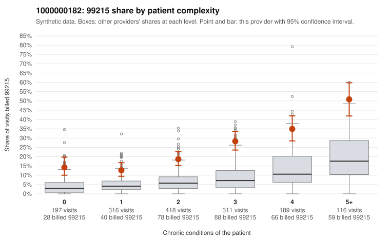

# 1000000182: 1000000182: too few returned records to judge

**Leaning (advisory):** Inconclusive

## Why

1000000182 billed 99215 on 23.2% of 1,547 claims against an expected 6.7% given patient complexity (risk-adjusted score 9.92; plain z-score vs peers 3.23). 19% of this provider's 99215 claims were on patients with 0 or 1 chronic conditions. Records came back for 30 claims. Of 6 documented 99215 claims, 0 (0%) were documented below the billed level, against 24% for the comparison providers. Note checks on 30 returned notes (share showing each sign): problems 0%, late 3%, unsigned 0%, data 0%. No audit trail was received. 3 of 21 notes claiming moderate-or-higher data reviewed had no lab or test line on the claim. The evidence does not support a call either way yet. Examples: C0086960: billed 99213; documented MDM level straightforward, minutes not recorded. C0086408: billed 99215, patient aged 36 with 0 chronic condition(s). C0086433: billed 99215, patient aged 34 with 0 chronic condition(s).

## Evidence chart

## Cited claims

`C0086960`, `C0086408`, `C0086433`

## Suggested next steps

- 30 charts came back but do not settle it: request a targeted sample of 99215 charts, starting with C0086960, C0086408, C0086433.
- Re-check after the targeted charts arrive; do not call upcoding or a sicker panel on this evidence alone.

---
Citations checked: 3/3 valid. Synthetic data. The leaning is advisory; the flag comes from the statistical screen, and no clinical documentation is available beyond the sampled records-review facts shown in the packet.
