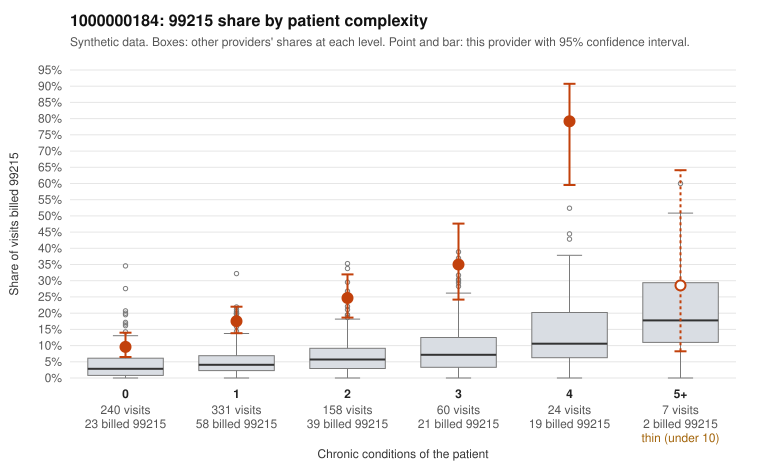

# 1000000184: 1000000184: too few returned records to judge

**Leaning (advisory):** Inconclusive

## Why

1000000184 billed 99215 on 19.8% of 820 claims against an expected 4.4% given patient complexity (risk-adjusted score 8.12; plain z-score vs peers 2.56). 50% of this provider's 99215 claims were on patients with 0 or 1 chronic conditions. Records came back for 30 claims. Of 7 documented 99215 claims, 0 (0%) were documented below the billed level, against 24% for the comparison providers. Note checks on 30 returned notes (share showing each sign): problems 40%, late 10%, unsigned 0%, data 7%, bulk created 0%, paste heavy 0%. 3 of 21 notes claiming moderate-or-higher data reviewed had no lab or test line on the claim. The evidence does not support a call either way yet. Examples: C0088718: billed 99214; documented MDM level low, minutes not recorded. C0088246: billed 99215, patient aged 48 with 1 chronic condition(s) (COPD). C0088280: billed 99215, patient aged 31 with 0 chronic condition(s).

## Evidence chart

## Cited claims

`C0088718`, `C0088246`, `C0088280`

## Suggested next steps

- 30 charts came back but do not settle it: request a targeted sample of 99215 charts, starting with C0088718, C0088246, C0088280.
- Re-check after the targeted charts arrive; do not call upcoding or a sicker panel on this evidence alone.

---
Citations checked: 3/3 valid. Synthetic data. The leaning is advisory; the flag comes from the statistical screen, and no clinical documentation is available beyond the sampled records-review facts shown in the packet.
