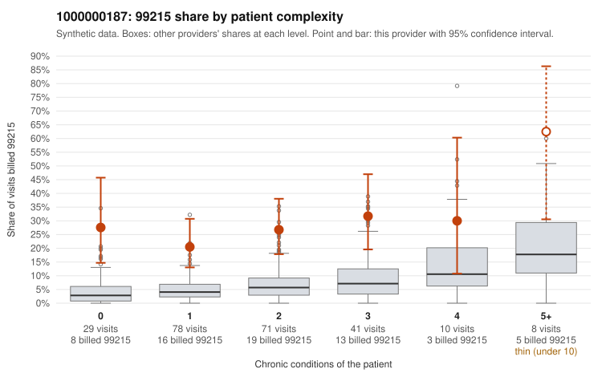

# 1000000187: 1000000187: too few returned records to judge

**Leaning (advisory):** Inconclusive

## Why

1000000187 billed 99215 on 27.0% of 237 claims against an expected 5.5% given patient complexity (risk-adjusted score 5.47; plain z-score vs peers 3.97). 38% of this provider's 99215 claims were on patients with 0 or 1 chronic conditions. Records came back for 30 claims. Of 8 documented 99215 claims, 0 (0%) were documented below the billed level, against 24% for the comparison providers. Note checks on 30 returned notes (share showing each sign): problems 27%, late 3%, unsigned 0%, data 7%. No audit trail was received. 2 of 27 notes claiming moderate-or-higher data reviewed had no lab or test line on the claim. The evidence does not support a call either way yet. Examples: C0090374: billed 99215, patient aged 56 with 1 chronic condition(s) (heart failure). C0090380: billed 99215, patient aged 56 with 1 chronic condition(s) (heart failure).

## Evidence chart

## Cited claims

`C0090374`, `C0090380`

## Suggested next steps

- 30 charts came back but do not settle it: request a targeted sample of 99215 charts, starting with C0090374, C0090380.
- Re-check after the targeted charts arrive; do not call upcoding or a sicker panel on this evidence alone.

---
Citations checked: 2/2 valid. Synthetic data. The leaning is advisory; the flag comes from the statistical screen, and no clinical documentation is available beyond the sampled records-review facts shown in the packet.
