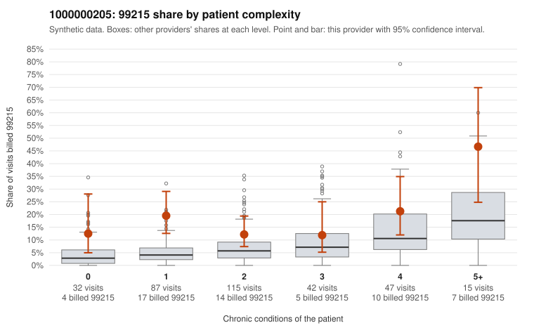

# 1000000205: 1000000205: too few returned records to judge

**Leaning (advisory):** Inconclusive

## Why

1000000205 billed 99215 on 16.9% of 338 claims against an expected 6.2% given patient complexity (risk-adjusted score 3.00; plain z-score vs peers 1.99). 37% of this provider's 99215 claims were on patients with 0 or 1 chronic conditions. Records came back for 30 claims. Of 7 documented 99215 claims, 2 (29%) were documented below the billed level, against 24% for the comparison providers. Note checks on 30 returned notes (share showing each sign): problems 7%, late 7%, unsigned 0%, data 7%. No audit trail was received. 5 of 20 notes claiming moderate-or-higher data reviewed had no lab or test line on the claim. The evidence does not support a call either way yet. Examples: C0100177: billed 99215; documented MDM level moderate, 34 minutes. C0100260: billed 99215; documented MDM level moderate, minutes not recorded. C0100156: billed 99215, patient aged 37 with 1 chronic condition(s) (hypertension). C0100195: billed 99215, patient aged 48 with 1 chronic condition(s) (type 2 diabetes).

## Evidence chart

## Cited claims

`C0100177`, `C0100260`, `C0100156`, `C0100195`

## Suggested next steps

- 30 charts came back but do not settle it: request a targeted sample of 99215 charts, starting with C0100177, C0100260, C0100156.
- Re-check after the targeted charts arrive; do not call upcoding or a sicker panel on this evidence alone.

---
Citations checked: 4/4 valid. Synthetic data. The leaning is advisory; the flag comes from the statistical screen, and no clinical documentation is available beyond the sampled records-review facts shown in the packet.
