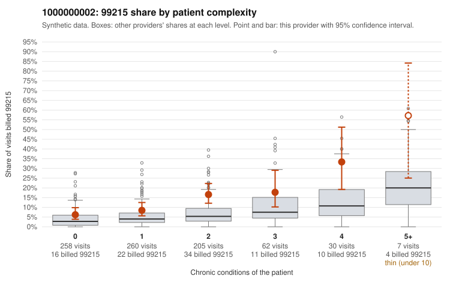

# 1000000002: 1000000002: too few returned records to judge

**Leaning (advisory):** Inconclusive

## Why

1000000002 billed 99215 on 11.8% of 822 claims against an expected 4.4% given patient complexity (risk-adjusted score 4.19; plain z-score vs peers 0.66). 39% of this provider's 99215 claims were on patients with 0 or 1 chronic conditions. Records came back for 30 claims. Of 1 documented 99215 claims, 1 (100%) were documented below the billed level, against 29% for the comparison providers. Note checks on 30 returned notes (share showing each sign): problems 30%, late 0%, unsigned 0%, data 3%. No audit trail was received. 3 of 17 notes claiming moderate-or-higher data reviewed had no lab or test line on the claim. The evidence does not support a call either way yet. Examples: C0000915: billed 99215, patient aged 36 with 1 chronic condition(s) (heart failure); documented MDM level low, minutes not recorded. C0000185: billed 99215, patient aged 44 with 0 chronic condition(s). C0000196: billed 99215, patient aged 53 with 1 chronic condition(s) (obesity).

## Evidence chart

## Cited claims

`C0000915`, `C0000185`, `C0000196`

## Suggested next steps

- 30 charts came back but do not settle it: request a targeted sample of 99215 charts, starting with C0000915, C0000185, C0000196.
- Re-check after the targeted charts arrive; do not call upcoding or a sicker panel on this evidence alone.

---
Citations checked: 3/3 valid. Synthetic data. The leaning is advisory; the flag comes from the statistical screen, and no clinical documentation is available beyond the sampled records-review facts shown in the packet.
