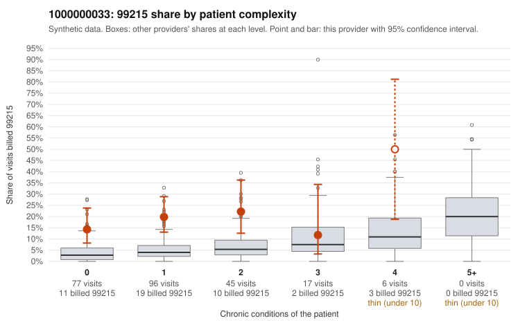

# 1000000033: 1000000033: 12 of 18 documented 99215 claims (67%) are documented below the billed level

**Leaning (advisory):** Pattern consistent with upcoding

## Why

1000000033 billed 99215 on 18.7% of 241 claims against an expected 4.1% given patient complexity (risk-adjusted score 4.62; plain z-score vs peers 1.68). 67% of this provider's 99215 claims were on patients with 0 or 1 chronic conditions. Records came back for 45 claims. Of 18 documented 99215 claims, 12 (67%) were documented below the billed level, against 29% for the comparison providers. Note checks on 45 returned notes (share showing each sign): problems 33%, late 0%, unsigned 0%, data 4%. No audit trail was received. 2 of 30 notes claiming moderate-or-higher data reviewed had no lab or test line on the claim. This pattern is consistent with upcoding. It is a reason to review the records, not a finding. Examples: C0016468: billed 99215, patient aged 51 with 0 chronic condition(s); documented MDM level moderate, 35 minutes. C0016581: billed 99215, patient aged 50 with 1 chronic condition(s) (hypertension); documented MDM level moderate, minutes not recorded. C0016589: billed 99215; documented MDM level moderate, 33 minutes. C0016421: billed 99215, patient aged 25 with 0 chronic condition(s). C0016435: billed 99215, patient aged 27 with 0 chronic condition(s). C0016436: billed 99215, patient aged 54 with 1 chronic condition(s) (atrial fibrillation); documented MDM level high, 41 minutes.

## Evidence chart

## Cited claims

`C0016468`, `C0016581`, `C0016589`, `C0016421`, `C0016435`, `C0016436`

## Suggested next steps

- Request the full charts for C0016468, C0016581, C0016589 and have a certified coder re-score each against the current E/M rules (medical decision making or total time).
- If the re-scoring confirms the pattern, review the random sample in the recovery packet's sampling plan before any overpayment estimate; do not extrapolate from a targeted sample.
- Look at the notes themselves: 33% address fewer problems than their level implies and 0% were signed late; request the audit trail for C0016468, C0016581, C0016589.

---
Citations checked: 6/6 valid. Synthetic data. The leaning is advisory; the flag comes from the statistical screen, and no clinical documentation is available beyond the sampled records-review facts shown in the packet.
