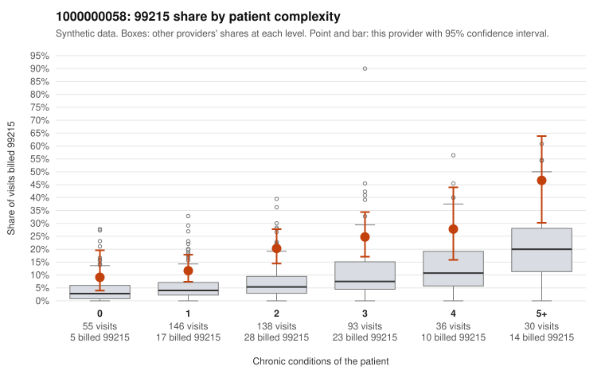

# 1000000058: 1000000058: too few returned records to judge

**Leaning (advisory):** Inconclusive

## Why

1000000058 billed 99215 on 19.5% of 498 claims against an expected 6.0% given patient complexity (risk-adjusted score 5.18; plain z-score vs peers 1.80). 23% of this provider's 99215 claims were on patients with 0 or 1 chronic conditions. Records came back for 45 claims. Of 19 documented 99215 claims, 6 (32%) were documented below the billed level, against 29% for the comparison providers. Note checks on 45 returned notes (share showing each sign): problems 13%, late 2%, unsigned 0%, data 9%. No audit trail was received. 4 of 34 notes claiming moderate-or-higher data reviewed had no lab or test line on the claim. The evidence does not support a call either way yet. Examples: C0029139: billed 99215; documented MDM level moderate, 39 minutes. C0029153: billed 99215; documented MDM level moderate, 30 minutes. C0029009: billed 99215, patient aged 45 with 0 chronic condition(s). C0029019: billed 99215, patient aged 51 with 1 chronic condition(s) (heart failure).

## Evidence chart

## Cited claims

`C0029139`, `C0029153`, `C0029009`, `C0029019`

## Suggested next steps

- 45 charts came back but do not settle it: request a targeted sample of 99215 charts, starting with C0029139, C0029153, C0029009.
- Re-check after the targeted charts arrive; do not call upcoding or a sicker panel on this evidence alone.

---
Citations checked: 4/4 valid. Synthetic data. The leaning is advisory; the flag comes from the statistical screen, and no clinical documentation is available beyond the sampled records-review facts shown in the packet.
