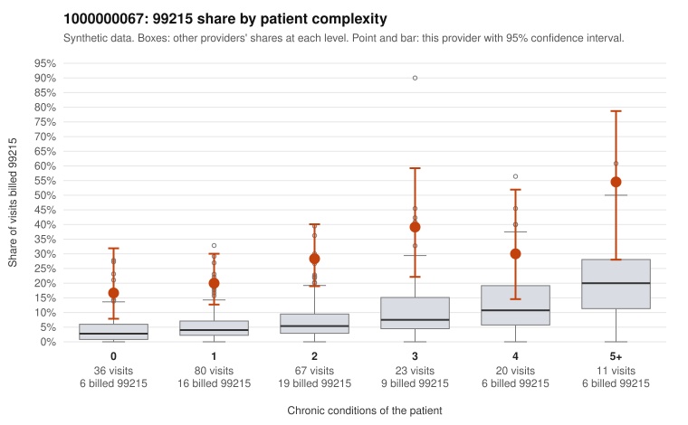

# 1000000067: 1000000067: too few returned records to judge

**Leaning (advisory):** Inconclusive

## Why

1000000067 billed 99215 on 26.2% of 237 claims against an expected 5.5% given patient complexity (risk-adjusted score 5.70; plain z-score vs peers 2.80). 35% of this provider's 99215 claims were on patients with 0 or 1 chronic conditions. Records came back for 45 claims. Of 24 documented 99215 claims, 10 (42%) were documented below the billed level, against 29% for the comparison providers. Note checks on 45 returned notes (share showing each sign): problems 18%, late 9%, unsigned 0%, data 0%. No audit trail was received. 0 of 33 notes claiming moderate-or-higher data reviewed had no lab or test line on the claim. The evidence does not support a call either way yet. Examples: C0032943: billed 99215; documented MDM level moderate, 38 minutes. C0033049: billed 99215, patient aged 42 with 1 chronic condition(s) (hypertension); documented MDM level moderate, minutes not recorded. C0032956: billed 99215, patient aged 47 with 1 chronic condition(s) (obesity). C0032973: billed 99215, patient aged 45 with 0 chronic condition(s); documented MDM level high, 36 minutes.

## Evidence chart

## Cited claims

`C0032943`, `C0033049`, `C0032956`, `C0032973`

## Suggested next steps

- 45 charts came back but do not settle it: request a targeted sample of 99215 charts, starting with C0032943, C0033049, C0032956.
- Re-check after the targeted charts arrive; do not call upcoding or a sicker panel on this evidence alone.

---
Citations checked: 4/4 valid. Synthetic data. The leaning is advisory; the flag comes from the statistical screen, and no clinical documentation is available beyond the sampled records-review facts shown in the packet.
