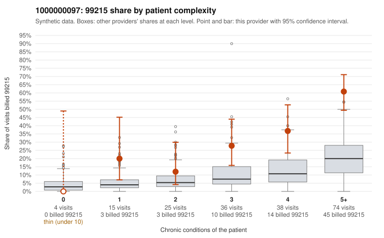

# 1000000097: 1000000097: too few returned records to judge

**Leaning (advisory):** Inconclusive

## Why

1000000097 billed 99215 on 39.1% of 192 claims against an expected 11.0% given patient complexity (risk-adjusted score 5.07; plain z-score vs peers 4.72). 4% of this provider's 99215 claims were on patients with 0 or 1 chronic conditions. Records came back for 21 claims. Of 17 documented 99215 claims, 2 (12%) were documented below the billed level, against 29% for the comparison providers. Note checks on 21 returned notes (share showing each sign): problems 5%, late 5%, unsigned 0%, data 0%. No audit trail was received. 0 of 19 notes claiming moderate-or-higher data reviewed had no lab or test line on the claim. The evidence does not support a call either way yet. Examples: C0047051: billed 99215, patient aged 69 with 4 chronic condition(s) (type 2 diabetes;depression;COPD;chronic kidney disease); documented MDM level moderate, minutes not recorded. C0047130: billed 99215; documented MDM level moderate, 38 minutes. C0046973: billed 99215, patient aged 62 with 1 chronic condition(s) (hyperlipidemia). C0046977: billed 99215, patient aged 58 with 1 chronic condition(s) (heart failure).

## Evidence chart

## Cited claims

`C0047051`, `C0047130`, `C0046973`, `C0046977`

## Suggested next steps

- 21 charts came back but do not settle it: request a targeted sample of 99215 charts, starting with C0047051, C0047130, C0046973.
- Re-check after the targeted charts arrive; do not call upcoding or a sicker panel on this evidence alone.

---
Citations checked: 4/4 valid. Synthetic data. The leaning is advisory; the flag comes from the statistical screen, and no clinical documentation is available beyond the sampled records-review facts shown in the packet.
