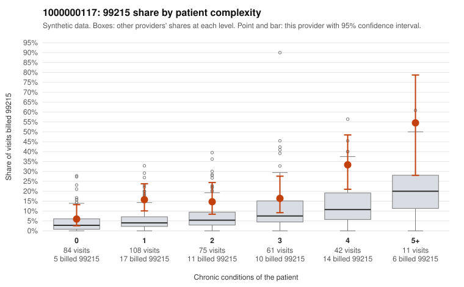

# 1000000117: 1000000117: too few returned records to judge

**Leaning (advisory):** Inconclusive

## Why

1000000117 billed 99215 on 16.5% of 381 claims against an expected 5.5% given patient complexity (risk-adjusted score 3.83; plain z-score vs peers 1.37). 35% of this provider's 99215 claims were on patients with 0 or 1 chronic conditions. Records came back for 6 claims. No documented 99215 claims came back. 0 of 3 notes claiming moderate-or-higher data reviewed had no lab or test line on the claim. The evidence does not support a call either way yet. Examples: C0054262: billed 99215, patient aged 53 with 1 chronic condition(s) (hyperlipidemia). C0054275: billed 99215, patient aged 54 with 1 chronic condition(s) (type 2 diabetes).

## Evidence chart

## Cited claims

`C0054262`, `C0054275`

## Suggested next steps

- 6 charts came back but do not settle it: request a targeted sample of 99215 charts, starting with C0054262, C0054275.
- Re-check after the targeted charts arrive; do not call upcoding or a sicker panel on this evidence alone.

---
Citations checked: 2/2 valid. Synthetic data. The leaning is advisory; the flag comes from the statistical screen, and no clinical documentation is available beyond the sampled records-review facts shown in the packet.
