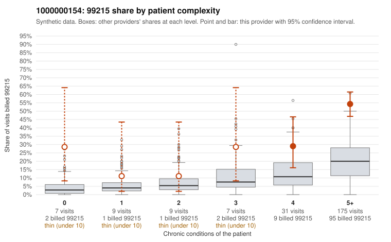

# 1000000154: 1000000154: too few returned records to judge

**Leaning (advisory):** Inconclusive

## Why

1000000154 billed 99215 on 46.2% of 238 claims against an expected 14.4% given patient complexity (risk-adjusted score 5.67; plain z-score vs peers 5.79). 3% of this provider's 99215 claims were on patients with 0 or 1 chronic conditions. Records came back for 30 claims. Of 15 documented 99215 claims, 1 (7%) were documented below the billed level, against 29% for the comparison providers. Note checks on 30 returned notes (share showing each sign): problems 3%, late 3%, unsigned 0%, data 0%. No audit trail was received. 2 of 23 notes claiming moderate-or-higher data reviewed had no lab or test line on the claim. The evidence does not support a call either way yet. Examples: C0069592: billed 99215, patient aged 57 with 0 chronic condition(s); documented MDM level moderate, 33 minutes. C0069471: billed 99215, patient aged 55 with 0 chronic condition(s).

## Evidence chart

## Cited claims

`C0069592`, `C0069471`

## Suggested next steps

- 30 charts came back but do not settle it: request a targeted sample of 99215 charts, starting with C0069592, C0069471.
- Re-check after the targeted charts arrive; do not call upcoding or a sicker panel on this evidence alone.

---
Citations checked: 2/2 valid. Synthetic data. The leaning is advisory; the flag comes from the statistical screen, and no clinical documentation is available beyond the sampled records-review facts shown in the packet.
