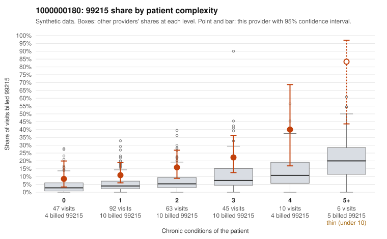

# 1000000180: 1000000180: too few returned records to judge

**Leaning (advisory):** Inconclusive

## Why

1000000180 billed 99215 on 16.4% of 263 claims against an expected 5.0% given patient complexity (risk-adjusted score 3.34; plain z-score vs peers 1.34). 33% of this provider's 99215 claims were on patients with 0 or 1 chronic conditions. Records came back for 13 claims. Of 5 documented 99215 claims, 0 (0%) were documented below the billed level, against 29% for the comparison providers. Note checks on 13 returned notes (share showing each sign): problems 31%, late 0%, unsigned 0%, data 8%. No audit trail was received. 2 of 8 notes claiming moderate-or-higher data reviewed had no lab or test line on the claim. The evidence does not support a call either way yet. Examples: C0081682: billed 99215, patient aged 30 with 1 chronic condition(s) (hypertension). C0081712: billed 99215, patient aged 45 with 1 chronic condition(s) (hypertension); documented MDM level high, minutes not recorded.

## Evidence chart

## Cited claims

`C0081682`, `C0081712`

## Suggested next steps

- 13 charts came back but do not settle it: request a targeted sample of 99215 charts, starting with C0081682, C0081712.
- Re-check after the targeted charts arrive; do not call upcoding or a sicker panel on this evidence alone.

---
Citations checked: 2/2 valid. Synthetic data. The leaning is advisory; the flag comes from the statistical screen, and no clinical documentation is available beyond the sampled records-review facts shown in the packet.
