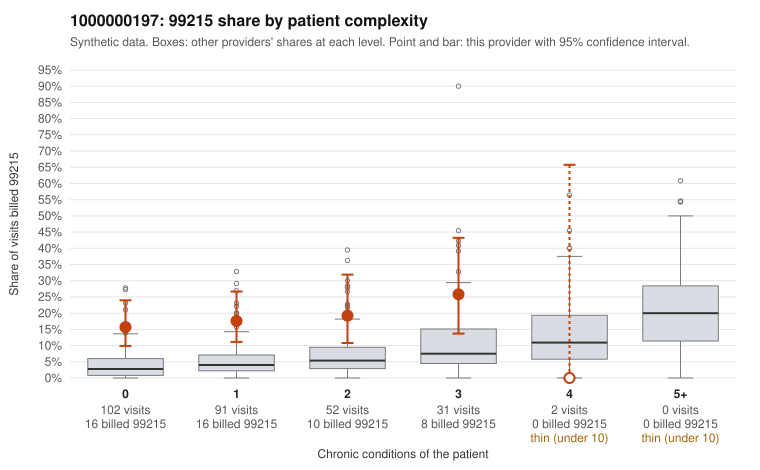

# 1000000197: 1000000197: too few returned records to judge

**Leaning (advisory):** Inconclusive

## Why

1000000197 billed 99215 on 18.0% of 278 claims against an expected 4.0% given patient complexity (risk-adjusted score 4.74; plain z-score vs peers 1.58). 64% of this provider's 99215 claims were on patients with 0 or 1 chronic conditions. Records came back for 45 claims. Of 22 documented 99215 claims, 5 (23%) were documented below the billed level, against 29% for the comparison providers. Note checks on 45 returned notes (share showing each sign): problems 36%, late 7%, unsigned 0%, data 7%, bulk created 0%, paste heavy 2%. 3 of 31 notes claiming moderate-or-higher data reviewed had no lab or test line on the claim. The evidence does not support a call either way yet. Examples: C0093366: billed 99215, patient aged 39 with 0 chronic condition(s); documented MDM level moderate, 31 minutes. C0093410: billed 99215; documented MDM level moderate, 31 minutes. C0093378: billed 99215, patient aged 30 with 1 chronic condition(s) (type 2 diabetes).

## Evidence chart

## Cited claims

`C0093366`, `C0093410`, `C0093378`

## Suggested next steps

- 45 charts came back but do not settle it: request a targeted sample of 99215 charts, starting with C0093366, C0093410, C0093378.
- Re-check after the targeted charts arrive; do not call upcoding or a sicker panel on this evidence alone.

---
Citations checked: 3/3 valid. Synthetic data. The leaning is advisory; the flag comes from the statistical screen, and no clinical documentation is available beyond the sampled records-review facts shown in the packet.
