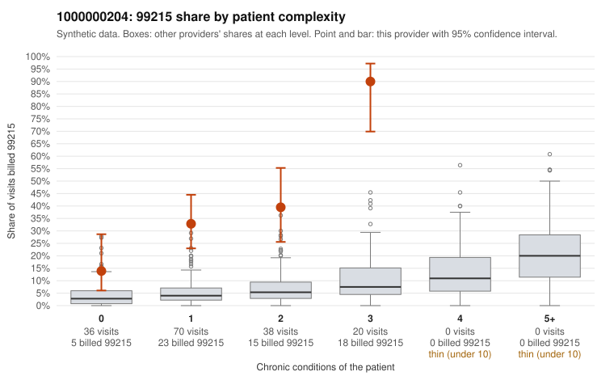

# 1000000204: 1000000204: too few returned records to judge

**Leaning (advisory):** Inconclusive

## Why

1000000204 billed 99215 on 37.2% of 164 claims against an expected 4.3% given patient complexity (risk-adjusted score 8.51; plain z-score vs peers 4.45). 46% of this provider's 99215 claims were on patients with 0 or 1 chronic conditions. Records came back for 29 claims. Of 10 documented 99215 claims, 1 (10%) were documented below the billed level, against 29% for the comparison providers. Note checks on 29 returned notes (share showing each sign): problems 45%, late 0%, unsigned 0%, data 0%. No audit trail was received. 3 of 20 notes claiming moderate-or-higher data reviewed had no lab or test line on the claim. The evidence does not support a call either way yet. Examples: C0095141: billed 99215, patient aged 48 with 1 chronic condition(s) (hypothyroidism); documented MDM level moderate, minutes not recorded. C0095024: billed 99215, patient aged 28 with 1 chronic condition(s) (hypertension). C0095025: billed 99215, patient aged 49 with 0 chronic condition(s).

## Evidence chart

## Cited claims

`C0095141`, `C0095024`, `C0095025`

## Suggested next steps

- 29 charts came back but do not settle it: request a targeted sample of 99215 charts, starting with C0095141, C0095024, C0095025.
- Re-check after the targeted charts arrive; do not call upcoding or a sicker panel on this evidence alone.

---
Citations checked: 3/3 valid. Synthetic data. The leaning is advisory; the flag comes from the statistical screen, and no clinical documentation is available beyond the sampled records-review facts shown in the packet.
