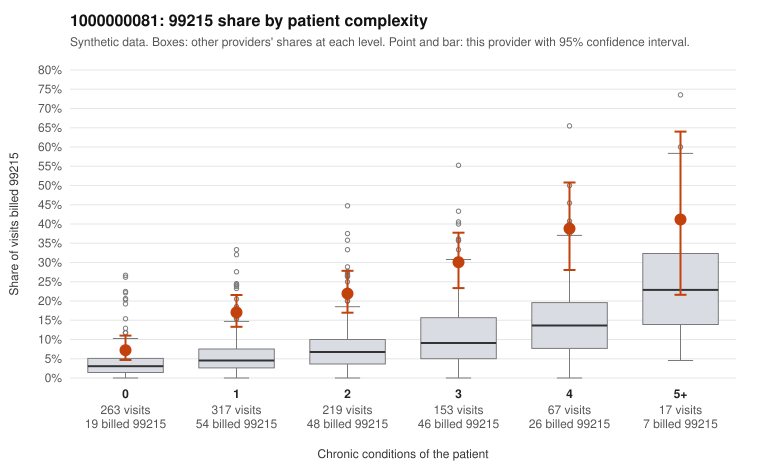

# 1000000081: 1000000081: too few returned records to judge

**Leaning (advisory):** Inconclusive

## Why

1000000081 billed 99215 on 19.3% of 1,036 claims against an expected 5.8% given patient complexity (risk-adjusted score 7.69; plain z-score vs peers 1.84). 36% of this provider's 99215 claims were on patients with 0 or 1 chronic conditions. Records came back for 30 claims. Of 6 documented 99215 claims, 1 (17%) were documented below the billed level, against 22% for the comparison providers. Note checks on 30 returned notes (share showing each sign): problems 33%, late 7%, unsigned 0%, data 3%. No audit trail was received. 1 of 25 notes claiming moderate-or-higher data reviewed had no lab or test line on the claim. The evidence does not support a call either way yet. Examples: C0034138: billed 99215; documented MDM level moderate, minutes not recorded. C0033819: billed 99215, patient aged 34 with 1 chronic condition(s) (atrial fibrillation). C0033944: billed 99215, patient aged 35 with 1 chronic condition(s) (hyperlipidemia).

## Evidence chart

## Cited claims

`C0034138`, `C0033819`, `C0033944`

## Suggested next steps

- 30 charts came back but do not settle it: request a targeted sample of 99215 charts, starting with C0034138, C0033819, C0033944.
- Re-check after the targeted charts arrive; do not call upcoding or a sicker panel on this evidence alone.

---
Citations checked: 3/3 valid. Synthetic data. The leaning is advisory; the flag comes from the statistical screen, and no clinical documentation is available beyond the sampled records-review facts shown in the packet.
