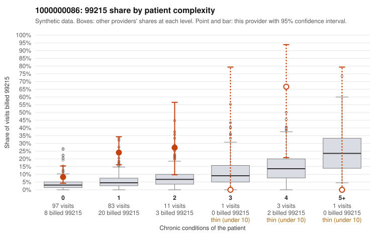

# 1000000086: 1000000086: too few returned records to judge

**Leaning (advisory):** Inconclusive

## Why

1000000086 billed 99215 on 16.8% of 196 claims against an expected 3.9% given patient complexity (risk-adjusted score 3.77; plain z-score vs peers 1.45). 85% of this provider's 99215 claims were on patients with 0 or 1 chronic conditions. Records came back for 30 claims. Of 6 documented 99215 claims, 3 (50%) were documented below the billed level, against 22% for the comparison providers. Note checks on 30 returned notes (share showing each sign): problems 60%, late 3%, unsigned 0%, data 0%. No audit trail was received. 1 of 21 notes claiming moderate-or-higher data reviewed had no lab or test line on the claim. The evidence does not support a call either way yet. Examples: C0035986: billed 99215; documented MDM level moderate, 37 minutes. C0035990: billed 99215, patient aged 44 with 1 chronic condition(s) (obesity); documented MDM level moderate, 32 minutes. C0035920: billed 99215, patient aged 41 with 1 chronic condition(s) (type 2 diabetes). C0035923: billed 99215, patient aged 49 with 1 chronic condition(s) (COPD); documented MDM level high, 49 minutes.

## Evidence chart

## Cited claims

`C0035986`, `C0035990`, `C0035920`, `C0035923`

## Suggested next steps

- 30 charts came back but do not settle it: request a targeted sample of 99215 charts, starting with C0035986, C0035990, C0035920.
- Re-check after the targeted charts arrive; do not call upcoding or a sicker panel on this evidence alone.

---
Citations checked: 4/4 valid. Synthetic data. The leaning is advisory; the flag comes from the statistical screen, and no clinical documentation is available beyond the sampled records-review facts shown in the packet.
