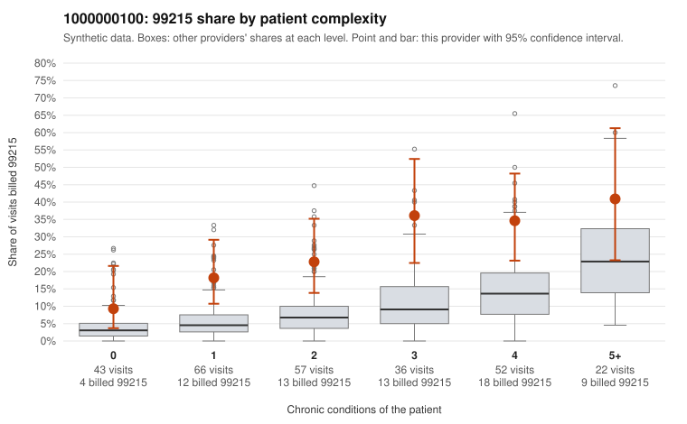

# 1000000100: 1000000100: too few returned records to judge

**Leaning (advisory):** Inconclusive

## Why

1000000100 billed 99215 on 25.0% of 276 claims against an expected 8.1% given patient complexity (risk-adjusted score 4.27; plain z-score vs peers 2.75). 23% of this provider's 99215 claims were on patients with 0 or 1 chronic conditions. Records came back for 30 claims. Of 7 documented 99215 claims, 0 (0%) were documented below the billed level, against 22% for the comparison providers. Note checks on 30 returned notes (share showing each sign): problems 23%, late 10%, unsigned 0%, data 0%. No audit trail was received. 2 of 27 notes claiming moderate-or-higher data reviewed had no lab or test line on the claim. The evidence does not support a call either way yet. Examples: C0045931: billed 99213; documented MDM level straightforward, minutes not recorded. C0045820: billed 99215, patient aged 40 with 1 chronic condition(s) (obesity). C0045824: billed 99215, patient aged 66 with 0 chronic condition(s).

## Evidence chart

## Cited claims

`C0045931`, `C0045820`, `C0045824`

## Suggested next steps

- 30 charts came back but do not settle it: request a targeted sample of 99215 charts, starting with C0045931, C0045820, C0045824.
- Re-check after the targeted charts arrive; do not call upcoding or a sicker panel on this evidence alone.

---
Citations checked: 3/3 valid. Synthetic data. The leaning is advisory; the flag comes from the statistical screen, and no clinical documentation is available beyond the sampled records-review facts shown in the packet.
