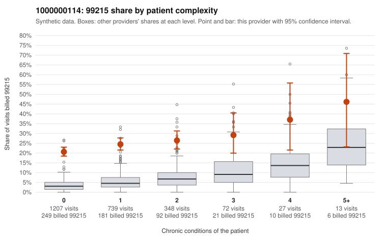

# 1000000114: 1000000114: 17 of 22 documented 99215 claims (77%) are documented below the billed level

**Leaning (advisory):** Pattern consistent with upcoding

## Why

1000000114 billed 99215 on 23.2% of 2,406 claims against an expected 4.2% given patient complexity (risk-adjusted score 19.46; plain z-score vs peers 2.47). 77% of this provider's 99215 claims were on patients with 0 or 1 chronic conditions. Records came back for 45 claims. Of 22 documented 99215 claims, 17 (77%) were documented below the billed level, against 22% for the comparison providers. Note checks on 45 returned notes (share showing each sign): problems 40%, late 7%, unsigned 0%, data 4%. No audit trail was received. 5 of 26 notes claiming moderate-or-higher data reviewed had no lab or test line on the claim. This pattern is consistent with upcoding. It is a reason to review the records, not a finding. Examples: C0052458: billed 99215; documented MDM level low, minutes not recorded. C0052513: billed 99215; documented MDM level moderate, minutes not recorded. C0052692: billed 99215; documented MDM level moderate, minutes not recorded. C0051982: billed 99215, patient aged 18 with 0 chronic condition(s). C0051989: billed 99215, patient aged 38 with 0 chronic condition(s). C0052030: billed 99215, patient aged 40 with 1 chronic condition(s) (depression).

## Evidence chart

## Cited claims

`C0052458`, `C0052513`, `C0052692`, `C0051982`, `C0051989`, `C0052030`

## Suggested next steps

- Request the full charts for C0052458, C0052513, C0052692 and have a certified coder re-score each against the current E/M rules (medical decision making or total time).
- If the re-scoring confirms the pattern, review the random sample in the recovery packet's sampling plan before any overpayment estimate; do not extrapolate from a targeted sample.
- Look at the notes themselves: 40% address fewer problems than their level implies and 7% were signed late; request the audit trail for C0052458, C0052513, C0052692.

---
Citations checked: 6/6 valid. Synthetic data. The leaning is advisory; the flag comes from the statistical screen, and no clinical documentation is available beyond the sampled records-review facts shown in the packet.
