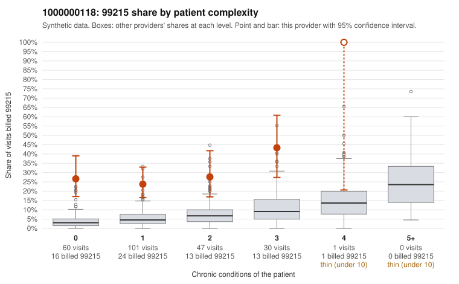

# 1000000118: 1000000118: 0 of 6 documented 99215 claims (0%) are documented below the billed level

**Leaning (advisory):** Pattern consistent with upcoding

## Why

1000000118 billed 99215 on 28.0% of 239 claims against an expected 4.9% given patient complexity (risk-adjusted score 6.82; plain z-score vs peers 3.23). 60% of this provider's 99215 claims were on patients with 0 or 1 chronic conditions. Records came back for 30 claims. Of 6 documented 99215 claims, 0 (0%) were documented below the billed level, against 22% for the comparison providers. Note checks on 30 returned notes (share showing each sign): problems 37%, late 20%, unsigned 0%, data 20%, bulk created 7%, paste heavy 17%. 7 of 20 notes claiming moderate-or-higher data reviewed had no lab or test line on the claim. This pattern is consistent with upcoding. It is a reason to review the records, not a finding. Examples: C0055906: billed 99214; documented MDM level low, minutes not recorded. C0055806: billed 99215, patient aged 35 with 0 chronic condition(s). C0055841: billed 99215, patient aged 47 with 1 chronic condition(s) (hypertension). C0055842: billed 99215, patient aged 27 with 0 chronic condition(s); documented MDM level high, minutes not recorded.

## Evidence chart

## Cited claims

`C0055906`, `C0055806`, `C0055841`, `C0055842`

## Suggested next steps

- Request the full charts for C0055906, C0055806, C0055841 and have a certified coder re-score each against the current E/M rules (medical decision making or total time).
- If the re-scoring confirms the pattern, review the random sample in the recovery packet's sampling plan before any overpayment estimate; do not extrapolate from a targeted sample.
- Look at the notes themselves: 37% address fewer problems than their level implies and 20% were signed late; request the audit trail for C0055906, C0055806, C0055841.

---
Citations checked: 4/4 valid. Synthetic data. The leaning is advisory; the flag comes from the statistical screen, and no clinical documentation is available beyond the sampled records-review facts shown in the packet.
