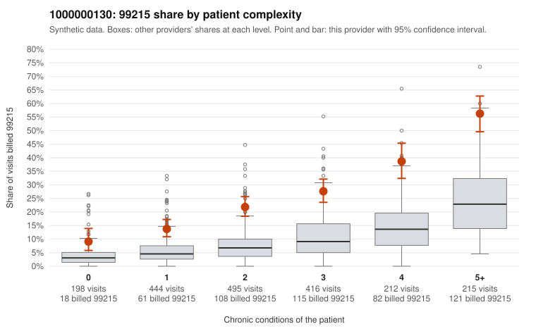

# 1000000130: 1000000130: documented 99215 claims mostly support the level billed (14% below)

**Leaning (advisory):** Pattern consistent with a high-acuity panel

## Why

1000000130 billed 99215 on 25.5% of 1,980 claims against an expected 8.5% given patient complexity (risk-adjusted score 11.39; plain z-score vs peers 2.83). 16% of this provider's 99215 claims were on patients with 0 or 1 chronic conditions. Records came back for 30 claims. Of 7 documented 99215 claims, 1 (14%) were documented below the billed level, against 22% for the comparison providers. Note checks on 30 returned notes (share showing each sign): problems 20%, late 7%, unsigned 0%, data 0%. No audit trail was received. 2 of 21 notes claiming moderate-or-higher data reviewed had no lab or test line on the claim. This pattern is consistent with a high-acuity panel. The sampled documentation supports the billed level. Examples: C0061105: billed 99215; documented MDM level high, 35 minutes. C0061164: billed 99215; documented MDM level high, 54 minutes. C0061421: billed 99215; documented MDM level high, 36 minutes. C0061082: billed 99215, patient aged 46 with 4 chronic condition(s) (type 2 diabetes;obesity;hyperlipidemia;hypertension). C0061084: billed 99215, patient aged 85 with 5 chronic condition(s) (type 2 diabetes;hyperlipidemia;hypertension;heart failure;asthma).

## Evidence chart

## Cited claims

`C0061105`, `C0061164`, `C0061421`, `C0061082`, `C0061084`

## Suggested next steps

- Do not pursue recovery on this evidence: 30 charts came back and they support the level billed (1 of 7 documented 99215 claims below the billed level).
- Revisit if the 99215 share keeps rising against peers or a larger sample shows unsupported claims.

---
Citations checked: 5/5 valid. Synthetic data. The leaning is advisory; the flag comes from the statistical screen, and no clinical documentation is available beyond the sampled records-review facts shown in the packet.
