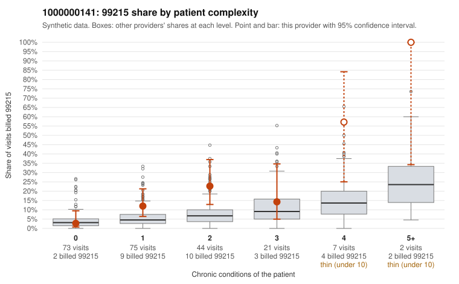

# 1000000141: 1000000141: too few returned records to judge

**Leaning (advisory):** Inconclusive

## Why

1000000141 billed 99215 on 13.5% of 222 claims against an expected 5.0% given patient complexity (risk-adjusted score 2.30; plain z-score vs peers 0.92). 37% of this provider's 99215 claims were on patients with 0 or 1 chronic conditions. Records came back for 29 claims. Of 4 documented 99215 claims, 0 (0%) were documented below the billed level, against 22% for the comparison providers. Note checks on 29 returned notes (share showing each sign): problems 31%, late 3%, unsigned 0%, data 10%. No audit trail was received. 5 of 18 notes claiming moderate-or-higher data reviewed had no lab or test line on the claim. The evidence does not support a call either way yet. Examples: C0068050: billed 99214; documented MDM level low, minutes not recorded. C0067838: billed 99215, patient aged 41 with 0 chronic condition(s); documented MDM level high, minutes not recorded. C0067854: billed 99215, patient aged 45 with 1 chronic condition(s) (hypothyroidism).

## Evidence chart

## Cited claims

`C0068050`, `C0067838`, `C0067854`

## Suggested next steps

- 29 charts came back but do not settle it: request a targeted sample of 99215 charts, starting with C0068050, C0067838, C0067854.
- Re-check after the targeted charts arrive; do not call upcoding or a sicker panel on this evidence alone.

---
Citations checked: 3/3 valid. Synthetic data. The leaning is advisory; the flag comes from the statistical screen, and no clinical documentation is available beyond the sampled records-review facts shown in the packet.
